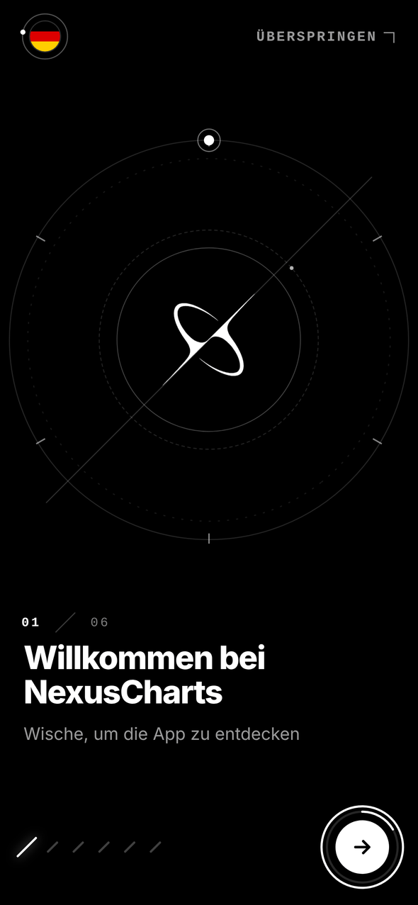
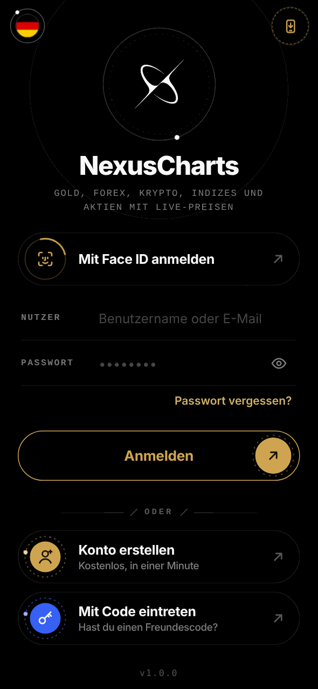
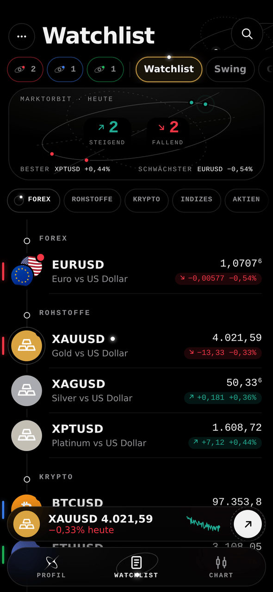
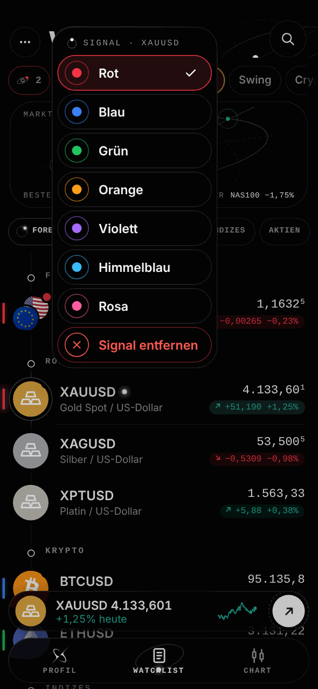
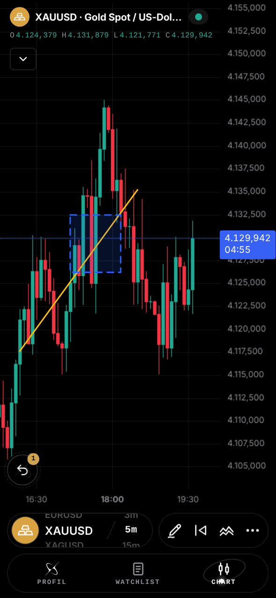
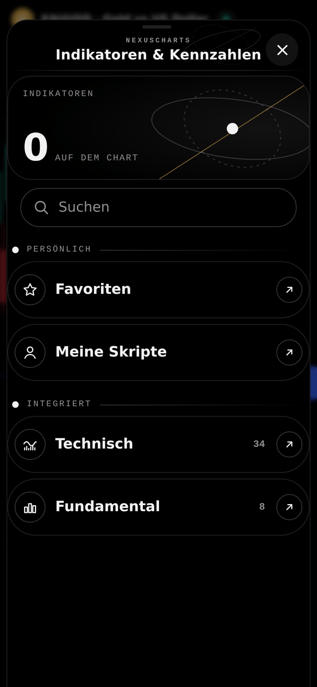
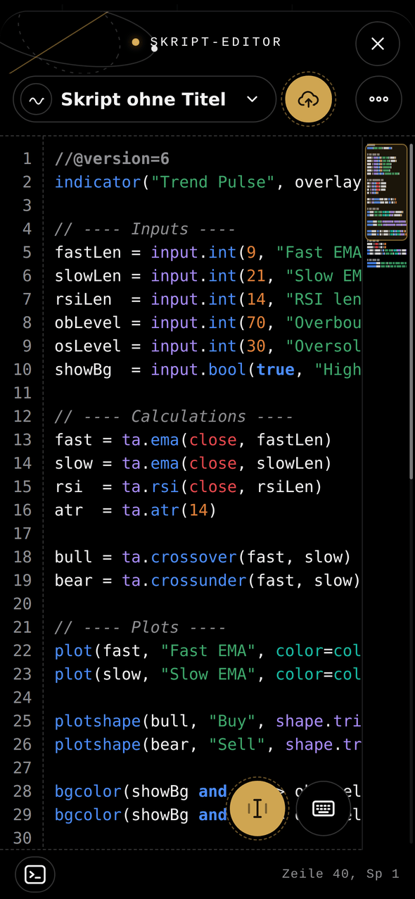
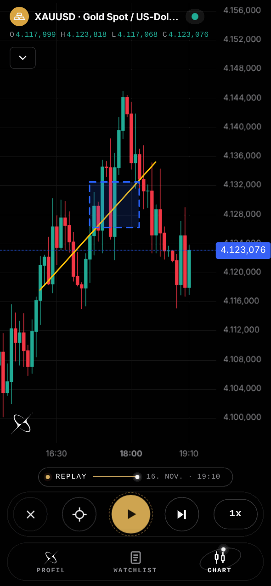

# NexusCharts

**Echtzeit-Charts, Indikatoren, Skripte und Alarme — immer in deiner Tasche.**
Eine schnelle, elegante Chart-App für iPhone, Android und Computer, mit tiefschwarzem Design im Stil von Umlaufbahnen.

[English](README.md) · [Italiano](README.it.md) · [Español](README.es.md) · [Français](README.fr.md) · **Deutsch**

<table>
  <tr>
    <td align="center" width="25%"> 1. Willkommen</td>
    <td align="center" width="25%"> 2. Anmeldung</td>
    <td align="center" width="25%"> 3. Watchlist</td>
    <td align="center" width="25%"> 4. Signale</td>
  </tr>
  <tr>
    <td align="center" width="25%"> 5. Chart & Zeichnungen</td>
    <td align="center" width="25%"> 6. Indikatoren</td>
    <td align="center" width="25%"> 7. Skript-Editor</td>
    <td align="center" width="25%"> 8. Bar Replay</td>
  </tr>
</table>

---

## 📖 Inhalt

- [Was ist NexusCharts](#-was-ist-nexuscharts)
- [Funktionen](#-funktionen)
- [Installation](#-installation)
- [So bekommst du Zugang](#-so-bekommst-du-zugang)
- [Kompatibilität](#-kompatibilität)
- [Datenschutz & Sicherheit](#-datenschutz--sicherheit)
- [Wie es gebaut ist](#%EF%B8%8F-wie-es-gebaut-ist)
- [Versionen](#-versionen)
- [FAQ](#-faq)
- [Roadmap](#-roadmap)
- [Danksagungen](#-danksagungen)

---

## ✨ Was ist NexusCharts

NexusCharts ist eine **Web-App**, die du auf deinem Home-Bildschirm installierst und die wie eine echte App funktioniert: Vollbild, mit eigenem Symbol, ohne App Store.
Sie ist für Trader gemacht, die **saubere Charts, Live-Preise, Indikatoren und Zeichenwerkzeuge** auf dem Telefon wollen, ohne Grenzen, Werbung oder Abos.

| | |
|---|---|
| ⚡ **Live-Preise** | Preise kommen live von unserem eigenen Datenserver, oft mehrmals pro Sekunde |
| 📈 **42 Indikatoren + deine Skripte** | Integrierte Bibliothek und eine mit Pine Script™ kompatible Engine |
| 🔔 **Echte Alarme** | Push-Benachrichtigungen, auch wenn die App geschlossen ist |
| 📱 **Wie eine native App** | Vollbild, haptisches Feedback, flüssige Animationen, keine Browserleisten |
| 🔄 **Immer aktuell** | Bei jedem Öffnen bekommst du automatisch die neueste Version |
| 🌍 **5 Sprachen · 2 Designs** | Italienisch, Englisch, Spanisch, Französisch, Deutsch · Dunkel und Hell |

> 📝 Was in jeder Version neu ist: siehe die Seite [Releases](../../releases).

### 🆕 Neu in 1.21.0 — Volumen und Niveaus neu

- 📊 OBV, Volumen, Pivot Points High Low, ZigZag und die Niveau-Indikatoren (Hoch und Tief von Vortag/Vorwoche, Eröffnungen, ADR, Änderung %, historische Volatilität, 52-Wochen-Hoch/-Tief, Sitzungshoch/-tief) neu gebaut mit den Einstellungen von TradingView plus Beschriftungen, weiteren Optionen und Alarmen.
- 🎯 Neu: Pivot Points Standard (Traditionell, Fibonacci, Woodie, Klassisch, DM, Camarilla) täglich, wöchentlich, monatlich, quartalsweise oder jährlich.
- ✅ Die gesamte Indikatorbibliothek ist jetzt neu gebaut.

### Vorher in 1.20.0 — Oszillatoren neu

- 📉 RSI, Stochastic RSI, Stochastik, MACD, CCI, DMI/ADX, ATR, MFI, Williams %R, Momentum, ROC, Awesome Oscillator und Aroon neu gebaut mit den Einstellungen und Startwerten von TradingView, dazu einstellbare Niveaus, andere Zeiteinheit und Alarme.
- 🔀 RSI: Glättung mit Bollinger-Bändern, überkaufte/überverkaufte Zonen und bullische/bärische Divergenzen.
- 🎨 MACD mit den vier Histogrammfarben und MA-Typ für Oszillator und Signal.

### Vorher in 1.19.0 — Bänder und Kanäle neu

- 📊 Bollinger-Bänder, %B, BandWidth, Keltner, Donchian, Envelope, Supertrend, Ichimoku, VWAP und lineare Regression neu gebaut mit den Einstellungen und Startwerten von TradingView, dazu MA-Typ, andere Zeiteinheit, Signale und Alarme, wo sinnvoll.
- 📐 Neu: Linear Regression Channel mit oberer/unterer Abweichung, verlängerbaren Linien und Pearson-R.
- 🛠️ Chart-Einstellungen › Legende: die Schalter funktionieren jetzt, und der Pfeil des Titel-Menüs sitzt richtig.

Vorher in 1.18.0 — Gleitende Durchschnitte neu, Legenden-Einstellungen

- 📈 Gleitende Durchschnitte neu gebaut mit den Einstellungen und Startwerten von TradingView (Glättung mit Bollinger-Bändern, andere Zeiteinheit, Warten auf Schluss der Zeiteinheit) plus Alarme beim Kreuzen des Preises. Neu: SMMA, DEMA, TEMA, LSMA, McGinley Dynamic und MA Cross; MA Ribbon mit 4 frei einstellbaren Durchschnitten.
- 🏷️ Chart-Einstellungen › Legende: Logo, Titel (Symbol, Name oder beides), Marktstatus, Chartwerte, Balkenänderung, Volumen, Änderung zum Vortag; für Indikatoren Titel, Eingaben, Werte und Hintergrund.
- 🔤 Die Indikator-Einstellungen erscheinen in deiner Sprache.

Vorher in 1.17.0 — Jeden Indikator anpassen

- 🎨 Stil, für jeden Indikator und jedes Skript: Darstellung (Linie, Stufenlinie, Histogramm, Kreuze, Fläche, Säulen, Kreise), durchgehend/gestrichelt/gepunktet, Stärke, Farbe, Preislinie, Beschriftung auf der Preisachse, Nachkommastellen, Werte und Eingaben in der Legende.
- 👁️ Sichtbarkeit mit Bereichen, zum Beispiel Minuten von 1 bis 15.
- 🔗 Quelle in deiner Sprache und das Ergebnis eines anderen Indikators im Chart als Quelle (zum Beispiel ein gleitender Durchschnitt des RSI).

Vorher in 1.16.0 — Indikatornamen im eigenen Bereich, Chart folgt dem Design

- 🏷️ Indikatoren mit eigenem Bereich unter dem Chart (RSI, MACD…) zeigen ihren Namen oben links in diesem Bereich; antippen für Ein-/Ausblenden, Einstellungen und Entfernen. Wird die Legende eingeklappt, verschwinden auch diese Namen.
- 🌗 Beim hellen Design wird der Chart weiß, beim dunklen wieder schwarz. Ein von Hand gewählter Hintergrund bleibt erhalten.

---

## 🚀 Funktionen

### 📋 Watchlist
- 79 Instrumente: Forex, Metalle, Energie, Indizes, Krypto und 7 US-Aktien, nach Kategorien gruppiert
- Suche jedes Symbol und füge es mit einem Tipp hinzu
- Live-Preis, Tagesveränderung in Punkten und Prozent, Flaggen- und Münzsymbole
- Mini-Player unten mit dem ausgewählten Symbol und seinem Verlauf
- **Mehrere Watchlists** (*Alle Watchlists*: erstellen, umbenennen, löschen) und farbige **Signale** mit eigenen Tabs
- Paar gedrückt halten für Signal und Entfernen

### 📊 Chart
- Vollbild-Chart mit **Live-Aktualisierung** und **Countdown** der Kerze
- **Zeiteinheiten:** Minuten 1m · 3m · 5m · 15m · 30m · 45m — Stunden 1H · 2H · 3H · 4H — Tage 1D · 1W · 1M · 3M · 6M · 12M
- **Chart-Typen:** Kerzen · Balken · Linie · Fläche · Heikin Ashi
- **Eigene Farben:** Körper, Ränder und Dochte der Kerzen mit Deckkraft, dazu Hintergrund der Leinwand und Skalen
- **Schnellauswahl:** auf Symbol oder Zeiteinheit gedrückt halten und wischen, um sie sofort zu wechseln
- **Fadenkreuz** mit Preis- und Zeitangabe und einer **„+“-Taste** für schnelle Alarme
- **Vergleiche** ein zweites Symbol in Prozent
- Mit zwei Fingern zoomen, ziehen zum Scrollen, ein Bild des Charts teilen

### 📈 Indikatoren
- Bildschirm **Indikatoren & Kennzahlen** mit Suche, **Favoriten** (tippe auf den Stern) und **Meine Skripte**
- **34 technische:** SMA, EMA, WMA, HMA, VWMA, ALMA, MA Ribbon, Bollinger-Bänder (+ %B und BandWidth), Keltner, Donchian, Envelopes, Supertrend, Ichimoku, VWAP, Lineare Regression, RSI, Stoch RSI, Stochastik, MACD, CCI, ADX, ATR, MFI, Williams %R, Momentum, ROC, Awesome Oscillator, Aroon, OBV, Volumen, Pivot-Punkte, ZigZag
- **8 fundamentale** (aus den Preisen berechnet): Hoch/Tief des Vortags, Hoch/Tief der Vorwoche, Tageseröffnung, durchschnittliche Tagesspanne, Tagesveränderung %, historische Volatilität, 52-Wochen-Hoch/Tief, Hoch/Tief der Session
- **Kompakte Legende:** tippe auf einen Indikator, um ihn **ein- oder auszublenden**, seine **Einstellungen** zu öffnen oder ihn zu **entfernen**
- **Einstellungsfenster** mit **Eingaben**, **Stil** (Sichtbarkeit, Farbe und Stärke jeder Linie) und **Sichtbarkeit** (Minuten / Stunden / Tage)
- **Menü •••:** Einstellungen zurücksetzen oder **als Standard speichern** für das nächste Hinzufügen

### 🧩 Skript-Editor
- Schreibe eigene Indikatoren in einer mit **Pine Script™ kompatiblen** Sprache (v5/v6)
- Code-Editor mit Zeilennummern, Fehlerprüfung und Konsole
- Unterstützt Plots, Formen, Boxen, Linien, Beschriftungen, Tabellen, Füllungen, Eingaben, Alarme, höhere Zeiteinheiten und Sessions
- Speichere deine Skripte und füge sie über **Meine Skripte** zum Chart hinzu
- **Minimap** des Codes rechts: tippen oder ziehen, um durch lange Skripte zu springen
- Der Code der Skripte bleibt wie bei Pine Script™ immer auf Englisch; Menüs und Meldungen des Editors sind auf Deutsch

### ✏️ Zeichenwerkzeuge
Werden für jedes Symbol automatisch gespeichert.

| Gruppe | Werkzeuge |
|---|---|
| Trend | Trendlinie · Horizontale Linie · Paralleler Kanal |
| Prognose & Messung | Long-Position · Short-Position (mit Ziel, Stop und R:R) |
| Formen | Pinsel · Pfeil · Rechteck · Pfad · Ellipse |
| Anmerkungen | Text · Notiz |

Wähle eine Zeichnung aus, um sie zu verschieben, ihre Farbe, **Linienstärke und Stil** zu ändern oder sie zu löschen. Die Taste **Rückgängig** nimmt bis zu 30 Schritte zurück.

### 🔔 Alarme
- Erstelle einen Preisalarm über das **„+“** am Fadenkreuz oder in der Alarmverwaltung
- Alarmlinie auf dem Chart: tippe darauf, um sie zu löschen
- Liste aktiver und inaktiver Alarme, abbrechen und löschen
- **Push-Benachrichtigungen auch bei geschlossener App** (abschaltbar unter Profil › Benachrichtigungen)

### ⏪ Bar Replay
- Setze eine **Hilfslinie** genau auf die gewünschte Kerze und starte dort
- Abspielen mit 1x–10x oder Kerze für Kerze — ideal für Backtests

### 🧭 Chart-Hub
| Bereich | Was er macht |
|---|---|
| **Layouts** | Neu · Speichern · Öffnen deiner gespeicherten Chart-Einstellungen |
| **Chart** | Chart-Typ, Chart-Einstellungen, Leinwand, Symboldetails |
| **Analyse** | Vergleichen · Bar Replay · Alarme · Technische Analyse · Skript-Editor |
| **Technische Analyse** | Kauf-/Verkaufsanzeige aus Oszillatoren und gleitenden Durchschnitten |
| **Teilen** | Erstellt ein Bild deines Charts und öffnet das Teilen-Menü |

### 👤 Profil & Einstellungen
- Design (dunkel/hell), Sprache und Benachrichtigungen
- Formular, um ein Problem zu melden oder eine Idee vorzuschlagen
- Soziale Netzwerke: Telegram-Kanal, Instagram, TikTok, YouTube und X, die sich direkt in ihren Apps öffnen
- Daten aktualisieren, sicheres Zurücksetzen, Abmelden

---

## 📲 Installation

> 🌐 Die App ist unter **[nexuscharts.app](https://nexuscharts.app)**.

> NexusCharts wird über den Browser installiert — ohne App Store oder Play Store.

### 🍎 iPhone (Safari)
1. Öffne den NexusCharts-Link in **Safari**.
2. Tippe auf **Teilen** (das Quadrat mit dem Pfeil). Unter iOS 26 tippe zuerst auf die **drei Punkte ⋯**, dann auf **Teilen**.
3. Tippe auf **Zum Home-Bildschirm** (wenn du es nicht siehst, tippe auf **Mehr anzeigen**).
4. Lass **Als Web-App öffnen** aktiviert, prüfe, dass der Name **NexusCharts** ist, und tippe auf **Hinzufügen**.
5. Öffne **NexusCharts** vom Home-Bildschirm.

### 🤖 Android (Chrome)
1. Öffne den NexusCharts-Link in **Chrome**.
2. Tippe oben rechts auf die **drei Punkte ⋮**.
3. Tippe auf **App installieren** (oder **Zum Startbildschirm hinzufügen**) und bestätige.

### 💻 Computer (Chrome / Edge)
1. Öffne den NexusCharts-Link.
2. Klicke auf das **Installationssymbol** in der Adressleiste oder nutze die App in einem normalen Tab.

> 💡 Dieselbe Anleitung gibt es in der App: tippe oben rechts auf dem Anmeldebildschirm auf die Taste **Installieren** (sie erscheint nur, wenn die App im Browser geöffnet ist).

---

## 🔑 So bekommst du Zugang

1. Öffne **[nexuscharts.app](https://nexuscharts.app)** und tippe auf **Konto erstellen**.
2. Wähle Benutzername, E-Mail und Passwort und bestätige, dass du mindestens 18 Jahre alt bist und die Datenschutzerklärung gelesen hast.
3. Gib den 6-stelligen Code aus der E-Mail ein, und du bist drin.

Danach meldet dich die App von selbst an. Auf einem neuen Handy meldest du dich einfach mit Benutzername oder E-Mail und Passwort an.

Du hast einen **Freundescode**? Tippe auf **Mit Code eintreten** und gib ihn ein (Format `XXXX-XXXX`): Er funktioniert auf nur einem Gerät.

> 💬 Brauchst du Hilfe? Schreib an **support@nexuscharts.app**.

---

## ✅ Kompatibilität

| Gerät | Browser | Status |
|---|---|---|
| iPhone (iOS 16.4 oder neuer) | Safari | ✅ Empfohlen |
| iPhone | Chrome / Edge | ✅ Funktioniert (Installation über Teilen) |
| Android 10 oder neuer | Chrome | ✅ Unterstützt |
| Android | Samsung Internet / Edge | ✅ Funktioniert |
| iPad | Safari | ⚠️ Funktioniert, gemacht für Telefone |
| Computer | Chrome / Edge / Safari | ⚠️ Funktioniert, volle Computer-Version kommt |

**Voraussetzungen:** eine Internetverbindung. Push-Benachrichtigungen auf dem iPhone brauchen die App auf dem Home-Bildschirm.

---

## 🔒 Datenschutz & Sicherheit

- 👤 Für ein Konto braucht es nur **Benutzername, E-Mail und Passwort**. Dein Passwort sehen wir nie: Auf dem Server liegt nur ein verschlüsselter Fingerabdruck davon.
- 📜 Alle Details stehen in der **[Datenschutzerklärung](https://nexuscharts.app/privacy.html)**.
- 📱 Zeichnungen, Layouts, Indikatoren, Skripte und Einstellungen werden **nur auf deinem Gerät** gespeichert.
- 📡 Der Datenserver speichert nur Marktpreise: keine IP-Adressen und keine persönlichen Daten.
- 🔔 Wenn du Benachrichtigungen aktivierst, bleiben deine aktiven Preisalarme nur auf dem Server, um dich zu benachrichtigen; löschst du einen Alarm, ist er weg.
- 🔐 In diesem Repository sind keine Passwörter oder privaten Schlüssel gespeichert.
- 🛡️ **Schutz gegen das Erraten von Codes**: nach zu vielen falschen Codes aus demselben Netz pausiert die Anmeldung eine Weile und die App zeigt eine klare Meldung. Gültige Codes und verbundene Geräte sind nie betroffen.
- 🧹 **App zurücksetzen** löscht alles, was auf dem Gerät gespeichert ist.

---

## 🏗️ Wie es gebaut ist

- 🖥️ **Die App** (was du auf dem Bildschirm siehst) liegt in diesem Repository und wird als Web-App veröffentlicht.
- ⚙️ **Die Engine** läuft auf Cloudflare: ein **Kontoserver** (Registrierung, Anmeldung, E-Mails), ein **Datenserver**, der die Live-Preise liefert und den Kerzenverlauf speichert, und ein Server für Freundescodes und Alarme. Sie werden getrennt verwaltet und sind nicht Teil dieses Repositorys.
- 🔐 Schlüssel und Passwörter liegen nur in den verschlüsselten Einstellungen der Engine, nie im Code.

---

## 🔢 Versionen

Versionen haben drei Zahlen, **MAJOR.MINOR.PATCH** (zum Beispiel 0.44.0):

- **Erste Zahl**: große Änderungen.
- **Mittlere Zahl**: neue Funktionen.
- **Letzte Zahl**: Korrekturen und Verbesserungen.

---

## ❓ FAQ

<b>Muss ich bezahlen oder ein Abo abschließen?</b>

Nein. Installation und Nutzung von NexusCharts sind kostenlos — du brauchst nur ein kostenloses Konto mit Benutzername, E-Mail und Passwort.

<b>Brauche ich ein Broker-Konto?</b>

Nein. Du meldest dich mit deinem NexusCharts-Konto an, ohne Registrierung bei einem Broker.

<b>Kann ich in der App handeln?</b>

Nein. NexusCharts dient nur für Charts und Analyse — es platziert nie Orders.

<b>Kann ich meine eigenen Pine Script™-Indikatoren nutzen?</b>

Ja. Füge dein Skript im Skript-Editor ein, speichere es und füge es über Meine Skripte hinzu. Die meisten Funktionen von v5/v6 werden unterstützt; wenn etwas nicht geht, zeigt dir die Konsole die Zeile.

<b>Funktionieren Preisalarme bei geschlossener App?</b>

Ja, mit aktiven Push-Benachrichtigungen. Auf dem iPhone muss die App auf dem Home-Bildschirm installiert sein.

<b>Mein Freundescode wird angeblich schon auf einem anderen Gerät verwendet.</b>

Jeder Freundescode gilt nur auf einem Gerät. Auf einem anderen Gerät meldest du dich mit einem kostenlosen NexusCharts-Konto an: Es funktioniert auf allen deinen Geräten.

<b>Muss ich die App aktualisieren?</b>

Nein. Sie aktualisiert sich bei jedem Öffnen selbst.

<b>Werden Zeichnungen und Indikatoren zwischen Geräten synchronisiert?</b>

Noch nicht: sie werden auf dem Gerät gespeichert, auf dem du sie erstellt hast.

---

## 🗺️ Roadmap

| Status | Funktion |
|---|---|
| ✅ | Watchlist, Live-Chart, Zeiteinheiten, Chart-Typen, eigene Farben |
| ✅ | Zeichenwerkzeuge, Bar Replay, Chart-Hub, Layouts |
| ✅ | 42 integrierte Indikatoren, Favoriten, Indikator-Einstellungen |
| ✅ | Mit Pine Script™ kompatible Engine und Skript-Editor |
| ✅ | Preisalarme mit Push-Benachrichtigungen |
| ✅ | Dunkles und helles Design |
| ✅ | Design 3.0: Willkommensbildschirme, Logo-Animation, Sprachmenü mit Umlaufbahn |
| ✅ | Design-3.0-Anmeldung: Logo mit Umlaufbahn, Zugangscode in 8 Feldern, runde Flaggen |
| ✅ | 5 Sprachen: Italienisch, Englisch, Spanisch, Französisch, Deutsch |
| ✅ | Design 3.0 in der App, mehrere Watchlists, Signale, Linienstärke/-stil und Rückgängig |
| ✅ | Eigener Datenserver: Live-Preise, 79 Instrumente, Namen in 5 Sprachen |
| ✅ | NexusCharts-Konten, neue Adresse nexuscharts.app, Datenschutzerklärung |
| ✅ | Aktien: Apple, Microsoft, NVIDIA, Amazon, Alphabet, Meta, Tesla, mit Börsenzeiten |
| 🔜 | Längerer Kerzenverlauf (Jahre) |
| 🔜 | Volle Computer-Version |
| 💡 | Synchronisierung zwischen Geräten |

---

## 🙏 Danksagungen

- Charts mit [TradingView Lightweight Charts™](https://www.tradingview.com/lightweight-charts/) (Apache 2.0).
- Marktdaten von den NexusCharts-Servern. Die Preise dienen der Analyse und können von denen deines Brokers abweichen.
- Krypto-Icons von [cryptocurrency-icons](https://github.com/spothq/cryptocurrency-icons) (CC0 1.0).
- Aktien-Logos: Apple, NVIDIA, Google, Meta und Tesla von [Simple Icons](https://simpleicons.org) (CC0 1.0); Microsoft und Amazon von [Wikimedia Commons](https://commons.wikimedia.org) (gemeinfrei). Die Logos sind Marken ihrer jeweiligen Inhaber und dienen nur dazu, die Aktie zu erkennen; NexusCharts ist mit diesen Unternehmen nicht verbunden.
- TradingView und Pine Script sind Marken von TradingView, Inc. NexusCharts ist nicht mit TradingView verbunden.

---

## ⚠️ Haftungsausschluss

NexusCharts ist ein Analysewerkzeug. Nichts in der App ist eine Finanzberatung. Trading ist mit Risiken verbunden: recherchiere immer selbst.

**© 2026 NexusCharts — Alle Rechte vorbehalten.**

