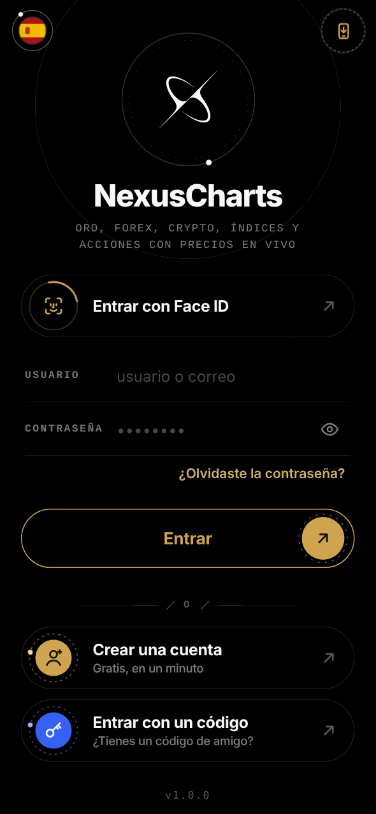
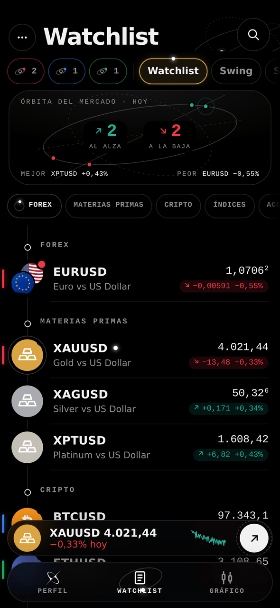
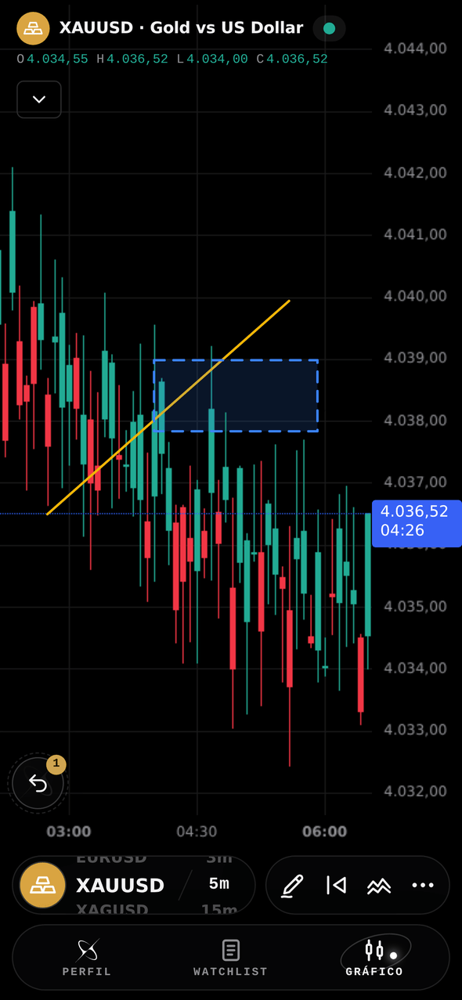
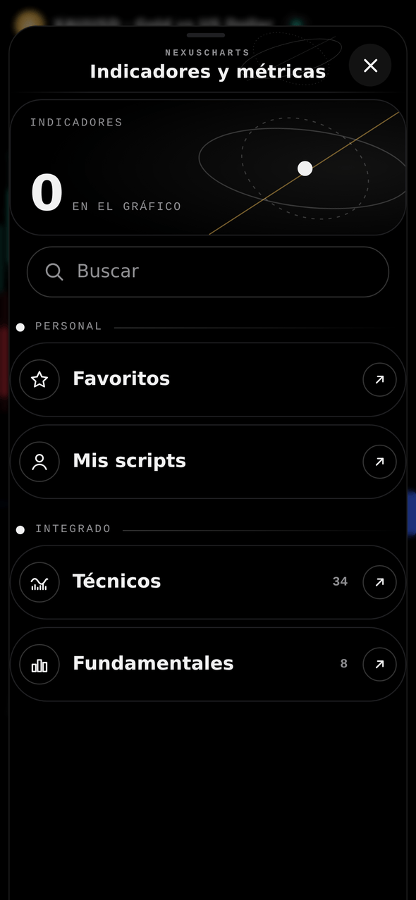
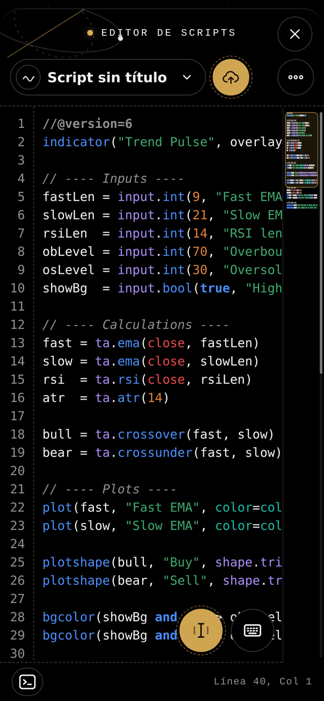

# NexusCharts

**Gráficos en tiempo real, indicadores, scripts y alertas — siempre en tu bolsillo.**
Una app de gráficos rápida y bonita para iPhone, Android y ordenador, con un diseño negro absoluto inspirado en las órbitas.

[English](README.md) · [Italiano](README.it.md) · **Español** · [Français](README.fr.md) · [Deutsch](README.de.md)

<table>
  <tr>
    <td align="center" width="25%"> 1. Bienvenida</td>
    <td align="center" width="25%"> 2. Acceso</td>
    <td align="center" width="25%"> 3. Watchlist</td>
    <td align="center" width="25%"> 4. Señales</td>
  </tr>
  <tr>
    <td align="center" width="25%"> 5. Gráfico y dibujos</td>
    <td align="center" width="25%"> 6. Indicadores</td>
    <td align="center" width="25%"> 7. Editor de scripts</td>
    <td align="center" width="25%"> 8. Bar Replay</td>
  </tr>
</table>

---

## 📖 Índice

- [Qué es NexusCharts](#-qué-es-nexuscharts)
- [Funciones](#-funciones)
- [Instalación](#-instalación)
- [Cómo conseguir acceso](#-cómo-conseguir-acceso)
- [Compatibilidad](#-compatibilidad)
- [Privacidad y seguridad](#-privacidad-y-seguridad)
- [Cómo está hecha](#%EF%B8%8F-cómo-está-hecha)
- [Números de versión](#-números-de-versión)
- [Preguntas frecuentes](#-preguntas-frecuentes)
- [Próximamente](#-próximamente)
- [Créditos](#-créditos)

---

## ✨ Qué es NexusCharts

NexusCharts es una **web app** que se instala en la pantalla de inicio y funciona como una app de verdad: a pantalla completa, con su propio icono, sin pasar por la App Store.
Está pensada para traders que quieren **gráficos limpios, precios en tiempo real, indicadores y herramientas de dibujo** en el móvil, sin límites, anuncios ni suscripciones.

| | |
|---|---|
| ⚡ **Precios en vivo** | Los precios llegan en directo desde nuestro servidor de datos, a menudo varias veces por segundo |
| 📈 **42 indicadores + tus scripts** | Biblioteca integrada y un motor compatible con Pine Script™ |
| 🔔 **Alertas de verdad** | Notificaciones push incluso con la app cerrada |
| 📱 **Como una app nativa** | Pantalla completa, vibración al tocar, animaciones fluidas, sin barras del navegador |
| 🔄 **Siempre actualizada** | Cada vez que la abres tienes la última versión, automáticamente |
| 🌍 **5 idiomas · 2 temas** | Italiano, inglés, español, francés, alemán · Oscuro y claro |

> 📝 Las novedades de cada versión están en la página [Releases](../../releases).

### 🆕 Novedades de la 1.12.0 — Velas de 4 horas con la jornada de Nueva York

- 🕔 Para oro, metales, energía, Forex e índices, las velas de 4 horas empiezan a las 17, 21, 1, 5, 9 y 13 de Nueva York: cada jornada termina a las 17 junto con la vela diaria, como en los brókers.
- 📈 La vela en vivo también se abre a esas horas. Cripto y acciones siguen igual.

### Anteriormente, en la 1.11.0 — Minutos del oro desde 2011

- ⏱️ El oro ahora tiene historial hasta enero de 2011 también en los gráficos de minutos: 1m, 3m, 5m, 15m, 30m y 45m.
- 👈 Como en las otras temporalidades, desliza el gráfico hacia la izquierda y las velas más antiguas se cargan solas.

### Anteriormente, en la 1.10.0 — Historial del oro desde 2011

- 📜 El oro ahora tiene historial de precios hasta enero de 2011 en los gráficos de 1H, 2H, 3H, 4H, diario, semanal y mensual.
- 👈 Desliza el gráfico hacia la izquierda: las velas más antiguas se cargan solas, sin moverte la vista.
- 🕔 Las velas diarias cierran a las 17:00 de Nueva York también en el pasado.
- 🙏 Parte del historial de precios procede de Dukascopy Bank SA (Perfil › Avisos legales › Créditos).

Anteriormente, en la 1.9.0 — Temporalidades desde 1 minuto

- ⏱️ Las temporalidades ahora empiezan en 1 minuto. Las de segundos se han quitado: no tenían historial y solo mostraban lo que llegaba con la app abierta.
- 🔁 Un gráfico o diseño guardado en segundos se abre en 1 minuto.

Anteriormente, en la 1.8.0 — Informes automáticos de errores

- 🛠️ Si algo falla en la app, desde la pantalla de bienvenida hasta el gráfico, tu dispositivo nos envía solo un breve informe técnico, para que podamos arreglarlo aunque nadie nos avise.
- 🔒 Solo datos técnicos (mensaje de error, pantalla, versión de la app, tipo de dispositivo y navegador): sin nombre, cuenta ni dirección IP. Los informes se borran a los 30 días. La política de privacidad lo explica.

Anteriormente, en la 1.7.0 — Conexión más estable

- ⚡ La conexión de la app con el servidor es más rápida y fiable, también cuando la cierras en iPhone.

---

## 🚀 Funciones

### 📋 Watchlist
- 79 instrumentos: Forex, metales, energía, índices, cripto y 7 acciones de EE. UU., agrupados por categoría
- Busca cualquier símbolo y añádelo con un toque
- Precio en vivo, variación diaria en puntos y porcentaje, iconos con banderas y monedas
- Mini reproductor abajo con el símbolo seleccionado y su minigráfico
- **Varias watchlists** (*Todas las watchlists*: crear, renombrar, eliminar) y **Señales** de colores con sus pestañas
- Mantén pulsado un par para Señal y Quitar

### 📊 Gráfico
- Gráfico a pantalla completa con **actualización en vivo** y **cuenta atrás** de la vela
- **Temporalidades:** minutos 1m · 3m · 5m · 15m · 30m · 45m — horas 1H · 2H · 3H · 4H — días 1D · 1W · 1M · 3M · 6M · 12M
- **Tipos de gráfico:** Velas · Barras · Línea · Área · Heikin Ashi
- **Colores personalizados:** cuerpo, bordes y mechas de las velas con opacidad, además del fondo y las escalas
- **Selector rápido:** mantén pulsado y desliza sobre la píldora del símbolo o de la temporalidad para cambiarla al instante
- **Retícula** con etiquetas de precio y hora y **botón "+"** para crear alertas rápidas
- **Compara** un segundo símbolo en porcentaje
- Pellizca para hacer zoom, arrastra para desplazarte, comparte una imagen del gráfico

### 📈 Indicadores
- Pantalla **Indicadores y métricas** con búsqueda, **Favoritos** (toca la estrella) y **Mis scripts**
- **34 Técnicos:** SMA, EMA, WMA, HMA, VWMA, ALMA, MA Ribbon, Bandas de Bollinger (+ %B y BandWidth), Keltner, Donchian, Envelopes, Supertrend, Ichimoku, VWAP, Regresión lineal, RSI, Stoch RSI, Estocástico, MACD, CCI, ADX, ATR, MFI, Williams %R, Momentum, ROC, Awesome Oscillator, Aroon, OBV, Volumen, Pivot Points, ZigZag
- **8 Fundamentales** (calculados a partir de los precios): máximo/mínimo del día y de la semana anterior, apertura diaria, rango medio diario, variación diaria %, volatilidad histórica, máximo/mínimo de 52 semanas, máximo/mínimo de la sesión
- **Leyenda compacta:** toca un indicador para **mostrarlo/ocultarlo**, abrir sus **ajustes** o **quitarlo**
- **Ventana de ajustes** con **Entradas**, **Estilo** (visibilidad, color y grosor de cada línea) y **Visibilidad** (minutos / horas / días)
- **Menú •••:** restablece los ajustes o **guarda como predeterminado** para la próxima vez que lo añadas

### 🧩 Editor de scripts
- Escribe tus propios indicadores en un lenguaje **compatible con Pine Script™** (v5/v6)
- Editor de código con números de línea, comprobación de errores y consola
- Admite plots, formas, cajas, líneas, etiquetas, tablas, rellenos, entradas, alertas, temporalidades superiores y sesiones
- Guarda tus scripts y añádelos al gráfico desde **Mis scripts**
- **Minimapa** del código a la derecha: toca o arrastra para moverte por scripts largos

### ✏️ Herramientas de dibujo
Se guardan automáticamente para cada símbolo.

| Grupo | Herramientas |
|---|---|
| Tendencia | Línea de tendencia · Línea horizontal · Canal paralelo |
| Previsión y medición | Posición larga · Posición corta (con objetivo, stop y R:R) |
| Formas | Pincel · Flecha · Rectángulo · Trayectoria · Elipse |
| Anotaciones | Texto · Nota |

Selecciona un dibujo para moverlo, cambiarle el color, **el grosor y el estilo** o eliminarlo. El botón **Deshacer** vuelve atrás hasta 30 pasos.

### 🔔 Alertas
- Crea una alerta de precio desde el **"+"** de la retícula o desde el gestor de **Alertas**
- Línea de la alerta en el gráfico: tócala para eliminarla
- Lista de activas / inactivas, cancelar y eliminar
- **Notificaciones push incluso con la app cerrada** (se desactivan en Perfil › Notificaciones)

### ⏪ Bar Replay
- Coloca una **línea guía** en la vela exacta que quieras y empieza desde ahí
- Reproduce de 1x a 10x o avanza vela a vela: perfecto para hacer backtesting

### 🧭 Centro del gráfico
| Sección | Qué hace |
|---|---|
| **Diseños** | Nuevo · Guardar · Abrir tus configuraciones del gráfico |
| **Gráfico** | Tipo, ajustes del gráfico, lienzo, detalles del símbolo |
| **Análisis** | Comparar · Bar Replay · Alertas · Técnicos · Editor de scripts |
| **Técnicos** | Indicador de compra/venta a partir de osciladores y medias móviles |
| **Compartir** | Crea una imagen del gráfico y abre el menú para compartir |

### 👤 Perfil y ajustes
- Tema (oscuro/claro), idioma y notificaciones
- Formulario para avisar de un problema o proponer una idea
- Redes sociales: canal de Telegram, Instagram, TikTok, YouTube y X, que se abren directamente en sus apps
- Actualizar datos, restablecimiento seguro, salir

---

## 📲 Instalación

> 🌐 La app está en **[nexuscharts.app](https://nexuscharts.app)**.

> NexusCharts se instala desde el navegador: sin App Store ni Play Store.

### 🍎 iPhone (Safari)
1. Abre el enlace de NexusCharts con **Safari**.
2. Toca **Compartir** (el cuadrado con la flecha). En iOS 26 toca primero los **tres puntos ⋯** y luego **Compartir**.
3. Toca **Añadir a pantalla de inicio** (si no lo ves, toca **Ver más**).
4. Deja activado **Abrir como app web**, comprueba que el nombre sea **NexusCharts** y toca **Añadir**.
5. Abre **NexusCharts** desde la pantalla de inicio.

### 🤖 Android (Chrome)
1. Abre el enlace de NexusCharts con **Chrome**.
2. Toca los **tres puntos ⋮** arriba a la derecha.
3. Toca **Instalar aplicación** (o **Añadir a pantalla de inicio**) y confirma.

### 💻 Ordenador (Chrome / Edge)
1. Abre el enlace de NexusCharts.
2. Haz clic en el **icono de instalar** de la barra de direcciones, o úsala en una pestaña normal.

> 💡 La misma guía está dentro de la app: toca **Instalar** arriba a la derecha en la pantalla de acceso (aparece solo cuando la app se abre desde el navegador).

---

## 🔑 Cómo conseguir acceso

1. Abre **[nexuscharts.app](https://nexuscharts.app)** y toca **Crear una cuenta**.
2. Elige usuario, correo y contraseña, y confirma que tienes al menos 18 años y que has leído la Política de Privacidad.
3. Escribe el código de 6 cifras que llega por correo y ya estás dentro.

A partir de ahí la app te deja entrar sola. Si cambias de teléfono, entra con tu usuario o correo y contraseña.

¿Tienes un **código de amigo**? Toca **Entrar con un código** y escríbelo (formato `XXXX-XXXX`): funciona en un solo dispositivo.

> 💬 ¿Necesitas ayuda? Escribe a **support@nexuscharts.app**.

---

## ✅ Compatibilidad

| Dispositivo | Navegador | Estado |
|---|---|---|
| iPhone (iOS 16.4 o posterior) | Safari | ✅ Recomendado |
| iPhone | Chrome / Edge | ✅ Funciona (instalar desde Compartir) |
| Android 10 o posterior | Chrome | ✅ Compatible |
| Android | Samsung Internet / Edge | ✅ Funciona |
| iPad | Safari | ⚠️ Funciona, pensada para móviles |
| Ordenador | Chrome / Edge / Safari | ⚠️ Funciona, versión completa para ordenador en camino |

**Requisitos:** conexión a internet. En iPhone las notificaciones push necesitan la app instalada en la pantalla de inicio.

---

## 🔒 Privacidad y seguridad

- 👤 Para la cuenta solo hacen falta **usuario, correo y contraseña**. Nunca vemos tu contraseña: en el servidor solo hay una huella cifrada.
- 📜 Todos los detalles están en la **[Política de Privacidad](https://nexuscharts.app/privacy.html)**.
- 📱 Dibujos, diseños, indicadores, scripts y ajustes se guardan **solo en tu dispositivo**.
- 📡 El servidor de datos guarda solo precios de mercado: ninguna dirección IP ni datos personales.
- 🔔 Si activas las notificaciones, tus alertas activas se guardan en el servidor solo para avisarte; borras la alerta y desaparece.
- 🔐 En este repositorio no hay contraseñas ni claves privadas.
- 🛡️ **Protección contra quien intenta adivinar los códigos**: tras demasiados códigos erróneos desde la misma red, el acceso se pausa un rato y la app muestra un mensaje claro. Los códigos válidos y los dispositivos vinculados no se tocan.
- 🧹 **Restablecer la app** borra todo lo guardado en el dispositivo.

---

## 🏗️ Cómo está hecha

- 🖥️ **La app** (lo que ves en pantalla) está en este repositorio y se publica como web app.
- ⚙️ **El motor** funciona en Cloudflare: un **servidor de cuentas** (registro, acceso, correos), un **servidor de datos** que envía los precios en directo y guarda el historial de velas, y un servidor para los códigos de amigo y las alertas. Se gestionan aparte y no forman parte de este repositorio.
- 🔐 Las claves y contraseñas están solo en los ajustes cifrados del motor, nunca en el código.

---

## 🔢 Números de versión

Las versiones tienen tres números, **MAYOR.MENOR.CORRECCIÓN** (por ejemplo 0.43.0):

- **Primer número**: cambios grandes.
- **Número central**: funciones nuevas.
- **Último número**: correcciones y mejoras.

---

## ❓ Preguntas frecuentes

<b>¿Tengo que pagar o suscribirme?</b>

No. Instalar y usar NexusCharts es gratis: basta con crear una cuenta gratuita con usuario, correo y contraseña.

<b>¿Necesito una cuenta en un bróker?</b>

No. Entras con tu cuenta NexusCharts, sin registrarte en ningún bróker.

<b>¿Puedo operar desde la app?</b>

No. NexusCharts es solo para gráficos y análisis: nunca abre órdenes.

<b>¿Puedo usar mis indicadores de Pine Script™?</b>

Sí. Pega el script en el Editor de scripts, guárdalo y añádelo desde Mis scripts. Se admite la mayoría de las funciones v5/v6; si algo no lo está, la consola te indica la línea.

<b>¿Las alertas funcionan con la app cerrada?</b>

Sí, con las notificaciones push activadas. En iPhone la app debe estar instalada en la pantalla de inicio.

<b>El código de amigo dice que ya se usa en otro dispositivo.</b>

Cada código de amigo funciona en un solo dispositivo. En otro dispositivo, entra con una cuenta NexusCharts gratuita: funciona en todos tus dispositivos.

<b>¿Tengo que actualizar la app?</b>

No. Se actualiza sola cada vez que la abres.

<b>¿Los dibujos e indicadores se sincronizan entre dispositivos?</b>

Todavía no: se quedan en el dispositivo donde los creaste.

---

## 🗺️ Próximamente

| Estado | Función |
|---|---|
| ✅ | Watchlist, gráfico en vivo, temporalidades, tipos de gráfico, colores personalizados |
| ✅ | Herramientas de dibujo, Bar Replay, Centro del gráfico, diseños |
| ✅ | 42 indicadores integrados, favoritos, ajustes de indicador |
| ✅ | Motor compatible con Pine Script™ y editor de scripts |
| ✅ | Alertas de precio con notificaciones push |
| ✅ | 5 idiomas (alemán desde la 0.44.0), tema oscuro y claro |
| ✅ | Design 3.0: pantallas de bienvenida, animación del logo, menú de idiomas en órbita |
| ✅ | Acceso Design 3.0: logo de órbitas, código en 8 casillas, banderas redondas |
| ✅ | Design 3.0 dentro de la app, varias watchlists, Señales, grosor/estilo de dibujos y Deshacer |
| ✅ | Servidor de datos propio: precios en directo, 79 instrumentos, nombres en 5 idiomas |
| ✅ | Cuentas NexusCharts, nueva dirección nexuscharts.app, Política de Privacidad |
| ✅ | Acciones: Apple, Microsoft, NVIDIA, Amazon, Alphabet, Meta, Tesla, con horario de Bolsa |
| 🔜 | Historial de velas más largo (años) |
| 🔜 | Versión completa para ordenador |
| 💡 | Sincronización entre dispositivos |

---

## 🙏 Créditos

- Gráficos creados con [TradingView Lightweight Charts™](https://www.tradingview.com/lightweight-charts/) (Apache 2.0).
- Datos de mercado servidos por los servidores de NexusCharts. Los precios son para análisis y pueden diferir de los de tu bróker.
- Iconos cripto de [cryptocurrency-icons](https://github.com/spothq/cryptocurrency-icons) (CC0 1.0).
- Logotipos de las acciones: Apple, NVIDIA, Google, Meta y Tesla de [Simple Icons](https://simpleicons.org) (CC0 1.0); Microsoft y Amazon de [Wikimedia Commons](https://commons.wikimedia.org) (dominio público). Los logotipos son marcas de sus respectivos propietarios y solo sirven para reconocer el valor; NexusCharts no está vinculada a estas empresas.
- TradingView y Pine Script son marcas de TradingView, Inc. NexusCharts no está afiliada a TradingView.

---

## ⚠️ Aviso

NexusCharts es una herramienta de análisis. Nada en la app es asesoramiento financiero. El trading conlleva riesgos: haz siempre tu propio análisis.

**© 2026 NexusCharts — Todos los derechos reservados.**

