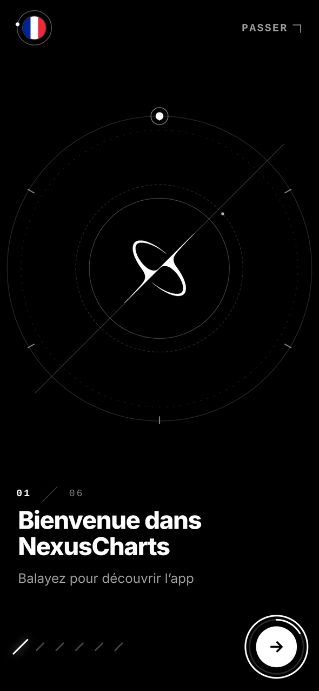
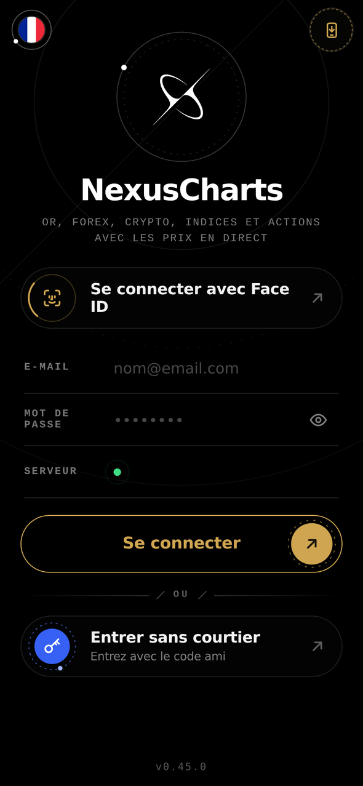
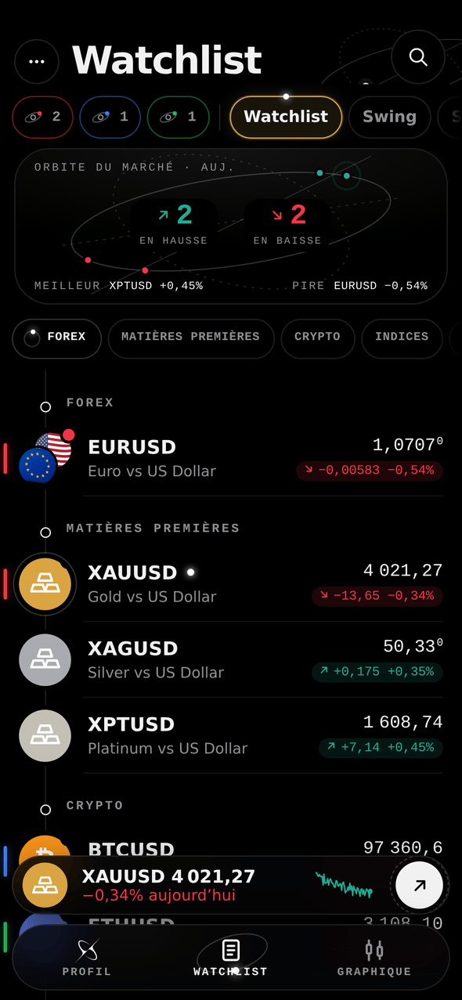
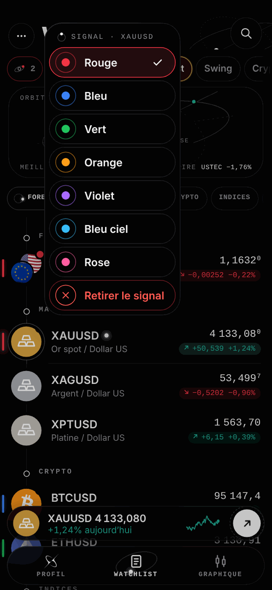
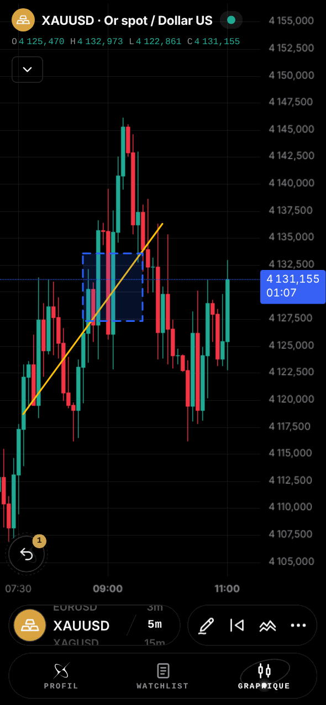
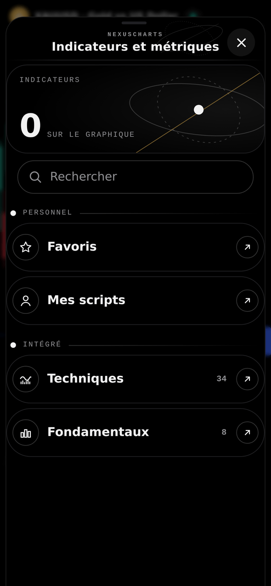
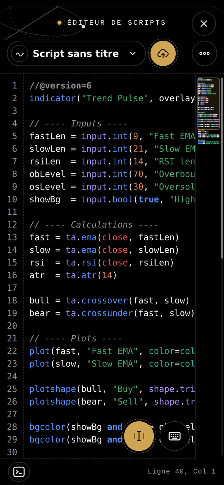
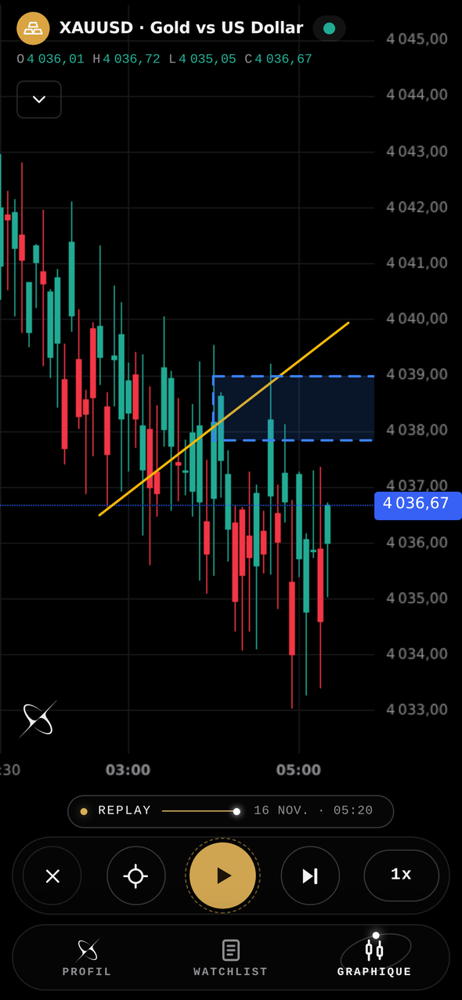

# NexusCharts

**Graphiques en temps réel, indicateurs, scripts et alertes — toujours dans ta poche.**
Une app de graphiques rapide et élégante pour iPhone, Android et ordinateur, avec un design noir absolu inspiré des orbites.

[English](README.md) · [Italiano](README.it.md) · [Español](README.es.md) · **Français** · [Deutsch](README.de.md)

<table>
  <tr>
    <td align="center" width="25%"> 1. Bienvenue</td>
    <td align="center" width="25%"> 2. Connexion</td>
    <td align="center" width="25%"> 3. Watchlist</td>
    <td align="center" width="25%"> 4. Signaux</td>
  </tr>
  <tr>
    <td align="center" width="25%"> 5. Graphique et dessins</td>
    <td align="center" width="25%"> 6. Indicateurs</td>
    <td align="center" width="25%"> 7. Éditeur de scripts</td>
    <td align="center" width="25%"> 8. Bar Replay</td>
  </tr>
</table>

---

## 📖 Sommaire

- [Qu'est-ce que NexusCharts](#-quest-ce-que-nexuscharts)
- [Fonctions](#-fonctions)
- [Installation](#-installation)
- [Comment obtenir l'accès](#-comment-obtenir-laccès)
- [Compatibilité](#-compatibilité)
- [Confidentialité et sécurité](#-confidentialité-et-sécurité)
- [Comment elle est faite](#%EF%B8%8F-comment-elle-est-faite)
- [Numéros de version](#-numéros-de-version)
- [Questions fréquentes](#-questions-fréquentes)
- [Prochainement](#-prochainement)
- [Crédits](#-crédits)

---

## ✨ Qu'est-ce que NexusCharts

NexusCharts est une **web app** qui s'installe sur l'écran d'accueil et fonctionne comme une vraie app : en plein écran, avec sa propre icône, sans passer par l'App Store.
Elle est pensée pour les traders qui veulent des **graphiques clairs, des prix en temps réel, des indicateurs et des outils de dessin** sur leur téléphone, sans limites, publicités ni abonnements.

| | |
|---|---|
| ⚡ **Prix en direct** | Les prix arrivent en direct depuis notre serveur de données, souvent plusieurs fois par seconde |
| 📈 **42 indicateurs + tes scripts** | Bibliothèque intégrée et un moteur compatible Pine Script™ |
| 🔔 **De vraies alertes** | Notifications push même quand l'app est fermée |
| 📱 **Comme une vraie app** | Plein écran, vibration au toucher, animations fluides, pas de barres du navigateur |
| 🔄 **Toujours à jour** | À chaque ouverture tu as la dernière version, automatiquement |
| 🌍 **5 langues · 2 thèmes** | Italien, anglais, espagnol, français, allemand · Sombre et clair |

> 📝 Les nouveautés de chaque version sont sur la page [Releases](../../releases).

### 🆕 Nouveautés de la 1.12.2 — Prise en charge de Pine v4

- 🧩 Les indicateurs Pine Script v4 fonctionnent aussi : fonctions sans ta./math./str., security(), iff(), tostring() et input(type=…).
- ➗ Pine v5 : diviser deux nombres entiers écrits dans le code donne un entier (5 / 2 = 2), comme sur TradingView. En v6 cela reste 2,5.
- 📊 Or : volume de ticks sur tout l'historique depuis 2011.

### Auparavant, dans la 1.12.1 — Volume de ticks

- 📊 Les bougies ont maintenant un volume de ticks (combien de fois le prix a changé), le même type de volume que TradingView utilise pour l'or et le Forex. Les indicateurs qui lisent le volume travaillent désormais avec des valeurs réelles.
- 🎨 Thème clair : le texte des indicateurs dessiné avec la couleur du texte du graphique est de nouveau visible.

### Auparavant, dans la 1.12.0 — Bougies de 4 heures sur la journée de New York

- 🕔 Pour l'or, les métaux, l'énergie, le Forex et les indices, les bougies de 4 heures commencent à 17 h, 21 h, 1 h, 5 h, 9 h et 13 h, heure de New York : chaque journée se termine à 17 h avec la bougie journalière, comme chez les courtiers.
- 📈 La bougie en direct s'ouvre aux mêmes heures. Cryptos et actions restent comme avant.

Auparavant, dans la 1.11.0 — Minutes de l'or depuis 2011

- ⏱️ L'or a désormais un historique jusqu'à janvier 2011 aussi sur les graphiques en minutes : 1m, 3m, 5m, 15m, 30m et 45m.
- 👈 Comme pour les autres unités de temps, fais glisser le graphique vers la gauche et les bougies plus anciennes se chargent toutes seules.

Auparavant, dans la 1.10.0 — Historique de l'or depuis 2011

- 📜 L'or a désormais un historique des prix jusqu'à janvier 2011 sur les graphiques 1H, 2H, 3H, 4H, journalier, hebdomadaire et mensuel.
- 👈 Fais glisser le graphique vers la gauche : les bougies plus anciennes se chargent toutes seules, sans déplacer ta vue.
- 🕔 Les bougies journalières clôturent à 17 h heure de New York aussi dans le passé.
- 🙏 Une partie de l'historique des prix provient de Dukascopy Bank SA (Profil › Mentions légales › Crédits).

Auparavant, dans la 1.9.0 — Unités de temps dès 1 minute

- ⏱️ Les unités de temps commencent désormais à 1 minute. Celles en secondes ont été retirées : elles n'avaient pas d'historique et ne montraient que ce qui arrivait pendant que l'app était ouverte.
- 🔁 Un graphique ou une disposition enregistrés en secondes s'ouvrent en 1 minute.

---

## 🚀 Fonctions

### 📋 Watchlist
- 79 instruments : Forex, métaux, énergie, indices, crypto et 7 actions américaines, regroupés par catégorie
- Cherche n'importe quel symbole et ajoute-le d'un toucher
- Prix en direct, variation du jour en points et en pourcentage, icônes avec drapeaux et pièces
- Mini lecteur en bas avec le symbole sélectionné et son mini-graphique
- **Plusieurs watchlists** (*Toutes les watchlists* : créer, renommer, supprimer) et **Signaux** en couleur avec leurs onglets
- Appui long sur une paire pour Signal et Retirer

### 📊 Graphique
- Graphique plein écran avec **mise à jour en direct** et **compte à rebours** de la bougie
- **Unités de temps :** minutes 1m · 3m · 5m · 15m · 30m · 45m — heures 1H · 2H · 3H · 4H — jours 1D · 1W · 1M · 3M · 6M · 12M
- **Types de graphique :** Bougies · Barres · Ligne · Aire · Heikin Ashi
- **Couleurs personnalisées :** corps, bordures et mèches des bougies avec opacité, plus le fond et les échelles
- **Sélecteur rapide :** maintiens et glisse sur la pastille du symbole ou de l'unité de temps pour la changer aussitôt
- **Réticule** avec étiquettes de prix et d'heure et **bouton « + »** pour créer des alertes rapides
- **Compare** un second symbole en pourcentage
- Pince pour zoomer, glisse pour défiler, partage une image du graphique

### 📈 Indicateurs
- Écran **Indicateurs et métriques** avec recherche, **Favoris** (touche l'étoile) et **Mes scripts**
- **34 Techniques :** SMA, EMA, WMA, HMA, VWMA, ALMA, MA Ribbon, Bandes de Bollinger (+ %B et BandWidth), Keltner, Donchian, Enveloppes, Supertrend, Ichimoku, VWAP, Régression linéaire, RSI, Stoch RSI, Stochastique, MACD, CCI, ADX, ATR, MFI, Williams %R, Momentum, ROC, Awesome Oscillator, Aroon, OBV, Volume, Points pivots, ZigZag
- **8 Fondamentaux** (calculés à partir des prix) : plus haut/plus bas de la veille et de la semaine précédente, ouverture du jour, range moyen journalier, variation du jour %, volatilité historique, plus haut/plus bas sur 52 semaines, plus haut/plus bas de la session
- **Légende compacte :** touche un indicateur pour l'**afficher/masquer**, ouvrir ses **réglages** ou le **retirer**
- **Fenêtre de réglages** avec **Paramètres**, **Style** (visibilité, couleur et épaisseur de chaque ligne) et **Visibilité** (minutes / heures / jours)
- **Menu ••• :** réinitialise les réglages ou **enregistre par défaut** pour le prochain ajout

### 🧩 Éditeur de scripts
- Écris tes propres indicateurs dans un langage **compatible Pine Script™** (v5/v6)
- Éditeur de code avec numéros de ligne, vérification des erreurs et console
- Prend en charge plots, formes, boîtes, lignes, étiquettes, tableaux, remplissages, paramètres, alertes, unités de temps supérieures et sessions
- Enregistre tes scripts et ajoute-les au graphique depuis **Mes scripts**
- **Minicarte** du code à droite : touche ou fais glisser pour parcourir les longs scripts

### ✏️ Outils de dessin
Enregistrés automatiquement pour chaque symbole.

| Groupe | Outils |
|---|---|
| Tendance | Ligne de tendance · Ligne horizontale · Canal parallèle |
| Prévision et mesure | Position longue · Position courte (avec objectif, stop et R:R) |
| Formes | Pinceau · Flèche · Rectangle · Chemin · Ellipse |
| Annotations | Texte · Note |

Sélectionne un dessin pour le déplacer, changer sa couleur, **son épaisseur et son style** ou le supprimer. Le bouton **Annuler** revient jusqu'à 30 étapes en arrière.

### 🔔 Alertes
- Crée une alerte de prix depuis le **« + »** du réticule ou depuis le gestionnaire d'**Alertes**
- Ligne de l'alerte sur le graphique : touche-la pour la supprimer
- Liste des alertes actives / inactives, annuler et supprimer
- **Notifications push même quand l'app est fermée** (désactivables dans Profil › Notifications)

### ⏪ Bar Replay
- Place une **ligne guide** sur la bougie exacte que tu veux et démarre de là
- Lecture de 1x à 10x ou bougie par bougie : parfait pour le backtest

### 🧭 Hub du graphique
| Section | Ce qu'elle fait |
|---|---|
| **Mises en page** | Nouveau · Enregistrer · Ouvrir tes configurations de graphique |
| **Graphique** | Type, réglages du graphique, canevas, détails du symbole |
| **Analyse** | Comparer · Bar Replay · Alertes · Techniques · Éditeur de scripts |
| **Techniques** | Jauge achat/vente à partir des oscillateurs et des moyennes mobiles |
| **Partager** | Crée une image du graphique et ouvre le menu de partage |

### 👤 Profil et réglages
- Thème (sombre/clair), langue et notifications
- Formulaire pour signaler un problème ou proposer une idée
- Réseaux sociaux : chaîne Telegram, Instagram, TikTok, YouTube et X, qui s'ouvrent directement dans leurs apps
- Actualiser les données, réinitialisation sécurisée, déconnexion

---

## 📲 Installation

> 🌐 L'app est sur **[nexuscharts.app](https://nexuscharts.app)**.

> NexusCharts s'installe depuis le navigateur : pas besoin d'App Store ni de Play Store.

### 🍎 iPhone (Safari)
1. Ouvre le lien de NexusCharts dans **Safari**.
2. Touche **Partager** (le carré avec la flèche). Sur iOS 26, touche d'abord les **trois points ⋯**, puis **Partager**.
3. Touche **Sur l'écran d'accueil** (si tu ne le vois pas, touche **Afficher plus**).
4. Laisse **Ouvrir comme app web** activé, vérifie que le nom est **NexusCharts** et touche **Ajouter**.
5. Ouvre **NexusCharts** depuis l'écran d'accueil.

### 🤖 Android (Chrome)
1. Ouvre le lien de NexusCharts dans **Chrome**.
2. Touche les **trois points ⋮** en haut à droite.
3. Touche **Installer l'application** (ou **Ajouter à l'écran d'accueil**) et confirme.

### 💻 Ordinateur (Chrome / Edge)
1. Ouvre le lien de NexusCharts.
2. Clique sur l'**icône d'installation** dans la barre d'adresse, ou utilise-la dans un onglet normal.

> 💡 Le même guide est dans l'app : touche **Installer** en haut à droite de l'écran de connexion (il apparaît seulement quand l'app est ouverte depuis le navigateur).

---

## 🔑 Comment obtenir l'accès

1. Ouvre **[nexuscharts.app](https://nexuscharts.app)** et touche **Créer un compte**.
2. Choisis un pseudo, un e-mail et un mot de passe, et confirme que tu as au moins 18 ans et que tu as lu la Politique de Confidentialité.
3. Saisis le code à 6 chiffres reçu par e-mail et c'est fait.

Ensuite l'app te connecte toute seule. Sur un nouveau téléphone, connecte-toi avec ton pseudo ou ton e-mail et ton mot de passe.

Tu as un **code ami** ? Touche **Entrer avec un code** et saisis-le (format `XXXX-XXXX`) : il fonctionne sur un seul appareil.

> 💬 Besoin d'aide ? Écris à **support@nexuscharts.app**.

---

## ✅ Compatibilité

| Appareil | Navigateur | État |
|---|---|---|
| iPhone (iOS 16.4 ou ultérieur) | Safari | ✅ Recommandé |
| iPhone | Chrome / Edge | ✅ Fonctionne (installer via Partager) |
| Android 10 ou ultérieur | Chrome | ✅ Pris en charge |
| Android | Samsung Internet / Edge | ✅ Fonctionne |
| iPad | Safari | ⚠️ Fonctionne, pensée pour les téléphones |
| Ordinateur | Chrome / Edge / Safari | ⚠️ Fonctionne, version complète pour ordinateur à venir |

**Prérequis :** une connexion internet. Sur iPhone, les notifications push nécessitent l'app installée sur l'écran d'accueil.

---

## 🔒 Confidentialité et sécurité

- 👤 Un compte demande seulement un **pseudo, un e-mail et un mot de passe**. Nous ne voyons jamais ton mot de passe : le serveur n'en garde qu'une empreinte chiffrée.
- 📜 Tous les détails sont dans la **[Politique de Confidentialité](https://nexuscharts.app/privacy.html)**.
- 📱 Dessins, mises en page, indicateurs, scripts et réglages restent **uniquement sur ton appareil**.
- 📡 Le serveur de données ne conserve que les prix du marché : aucune adresse IP ni donnée personnelle.
- 🔔 Si tu actives les notifications, tes alertes actives sont gardées sur le serveur uniquement pour te prévenir ; supprime l'alerte et elle disparaît.
- 🔐 Ce dépôt ne contient aucun mot de passe ni clé privée.
- 🛡️ **Protection contre ceux qui essaient de deviner les codes** : après trop de codes erronés depuis le même réseau, la connexion se met en pause un moment et l'app affiche un message clair. Les codes valides et les appareils liés ne sont jamais touchés.
- 🧹 **Réinitialiser l'app** efface tout ce qui est enregistré sur l'appareil.

---

## 🏗️ Comment elle est faite

- 🖥️ **L'app** (ce que tu vois à l'écran) se trouve dans ce dépôt et est publiée comme web app.
- ⚙️ **Le moteur** tourne sur Cloudflare : un **serveur des comptes** (inscription, connexion, e-mails), un **serveur de données** qui diffuse les prix en direct et conserve l'historique des bougies, et un serveur pour les codes ami et les alertes. Ils sont gérés à part et ne font pas partie de ce dépôt.
- 🔐 Les clés et mots de passe se trouvent uniquement dans les réglages chiffrés du moteur, jamais dans le code.

---

## 🔢 Numéros de version

Les versions ont trois nombres, **MAJEUR.MINEUR.CORRECTIF** (par exemple 0.43.0) :

- **Premier nombre** : grands changements.
- **Nombre central** : nouvelles fonctions.
- **Dernier nombre** : corrections et améliorations.

---

## ❓ Questions fréquentes

<b>Dois-je payer ou m'abonner ?</b>

Non. Installer et utiliser NexusCharts est gratuit : il suffit de créer un compte gratuit avec un pseudo, un e-mail et un mot de passe.

<b>Ai-je besoin d'un compte chez un courtier ?</b>

Non. Tu te connectes avec ton compte NexusCharts, sans inscription chez un broker.

<b>Puis-je trader depuis l'app ?</b>

Non. NexusCharts sert uniquement aux graphiques et à l'analyse : elle ne passe jamais d'ordres.

<b>Puis-je utiliser mes indicateurs Pine Script™ ?</b>

Oui. Colle le script dans l'Éditeur de scripts, enregistre-le et ajoute-le depuis Mes scripts. La plupart des fonctions v5/v6 sont prises en charge ; sinon, la console t'indique la ligne.

<b>Les alertes fonctionnent-elles quand l'app est fermée ?</b>

Oui, avec les notifications push activées. Sur iPhone, l'app doit être installée sur l'écran d'accueil.

<b>Mon code ami est déjà utilisé sur un autre appareil.</b>

Chaque code ami ne fonctionne que sur un seul appareil. Sur un autre appareil, connecte-toi avec un compte NexusCharts gratuit : il fonctionne sur tous tes appareils.

<b>Dois-je mettre à jour l'app ?</b>

Non. Elle se met à jour toute seule à chaque ouverture.

<b>Les dessins et indicateurs se synchronisent-ils entre appareils ?</b>

Pas encore : ils restent sur l'appareil où tu les as créés.

---

## 🗺️ Prochainement

| État | Fonction |
|---|---|
| ✅ | Watchlist, graphique en direct, unités de temps, types de graphique, couleurs personnalisées |
| ✅ | Outils de dessin, Bar Replay, Hub du graphique, mises en page |
| ✅ | 42 indicateurs intégrés, favoris, réglages des indicateurs |
| ✅ | Moteur compatible Pine Script™ et éditeur de scripts |
| ✅ | Alertes de prix avec notifications push |
| ✅ | 5 langues (allemand depuis la 0.44.0), thème sombre et clair |
| ✅ | Design 3.0 : écrans de bienvenue, animation du logo, menu des langues en orbite |
| ✅ | Connexion Design 3.0 : logo en orbite, code en 8 cases, drapeaux ronds |
| ✅ | Design 3.0 dans l'app, plusieurs watchlists, Signaux, épaisseur/style des dessins et Annuler |
| ✅ | Notre propre serveur de données : prix en direct, 79 instruments, noms en 5 langues |
| ✅ | Comptes NexusCharts, nouvelle adresse nexuscharts.app, Politique de Confidentialité |
| ✅ | Actions : Apple, Microsoft, NVIDIA, Amazon, Alphabet, Meta, Tesla, avec les horaires de Bourse |
| 🔜 | Historique des bougies plus long (des années) |
| 🔜 | Version complète pour ordinateur |
| 💡 | Synchronisation entre appareils |

---

## 🙏 Crédits

- Graphiques réalisés avec [TradingView Lightweight Charts™](https://www.tradingview.com/lightweight-charts/) (Apache 2.0).
- Données de marché fournies par les serveurs NexusCharts. Les prix servent à l'analyse et peuvent différer de ceux de ton courtier.
- Icônes crypto de [cryptocurrency-icons](https://github.com/spothq/cryptocurrency-icons) (CC0 1.0).
- Logos des actions : Apple, NVIDIA, Google, Meta et Tesla de [Simple Icons](https://simpleicons.org) (CC0 1.0) ; Microsoft et Amazon de [Wikimedia Commons](https://commons.wikimedia.org) (domaine public). Les logos sont des marques de leurs propriétaires respectifs et servent seulement à reconnaître le titre ; NexusCharts n'est pas liée à ces entreprises.
- TradingView et Pine Script sont des marques de TradingView, Inc. NexusCharts n'est pas affiliée à TradingView.

---

## ⚠️ Avertissement

NexusCharts est un outil d'analyse. Rien dans l'app ne constitue un conseil financier. Le trading comporte des risques : fais toujours tes propres recherches.

**© 2026 NexusCharts — Tous droits réservés.**

