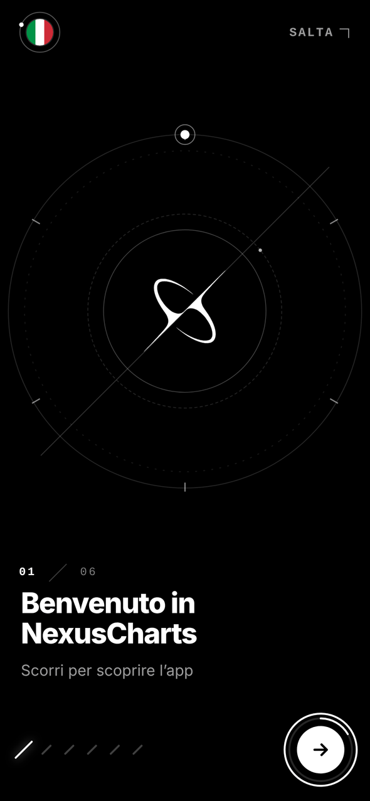
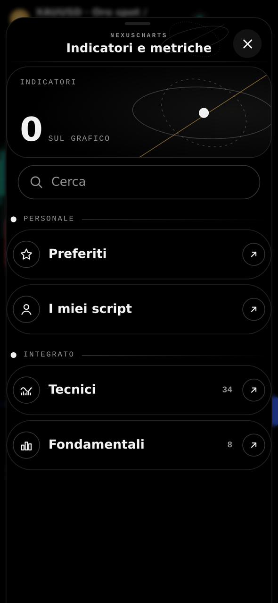
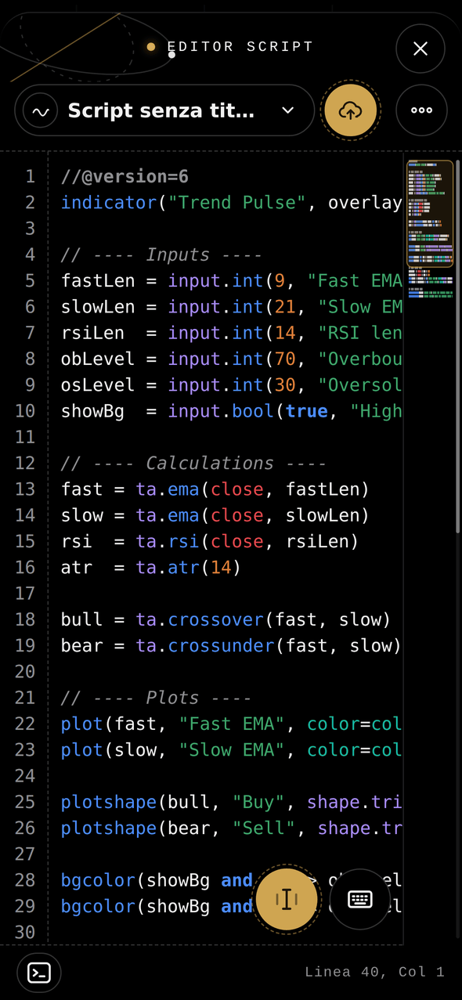
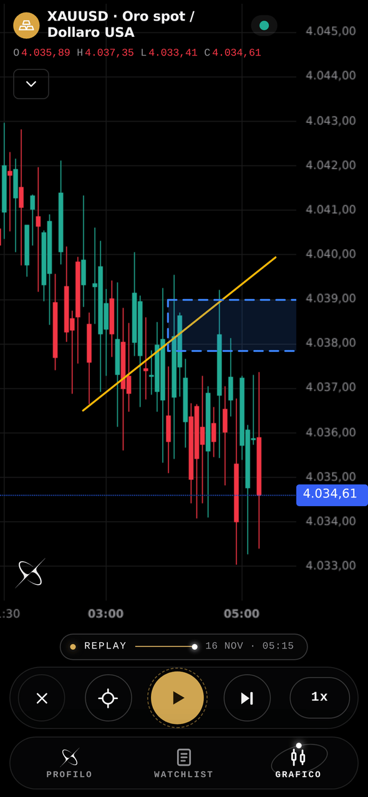

# NexusCharts

**Grafici in tempo reale, indicatori, script e alert — sempre in tasca.**
Un'app di grafici veloce e bella per iPhone, Android e computer, con un design nero assoluto ispirato alle orbite.

[English](README.md) · **Italiano** · [Español](README.es.md) · [Français](README.fr.md) · [Deutsch](README.de.md)

<table>
  <tr>
    <td align="center" width="25%"> 1. Benvenuto</td>
    <td align="center" width="25%"> 2. Accesso</td>
    <td align="center" width="25%"> 3. Watchlist</td>
    <td align="center" width="25%"> 4. Segnali</td>
  </tr>
  <tr>
    <td align="center" width="25%"> 5. Grafico e disegni</td>
    <td align="center" width="25%"> 6. Indicatori</td>
    <td align="center" width="25%"> 7. Editor di script</td>
    <td align="center" width="25%"> 8. Bar Replay</td>
  </tr>
</table>

---

## 📖 Indice

- [Cos'è NexusCharts](#-cosè-nexuscharts)
- [Funzioni](#-funzioni)
- [Installazione](#-installazione)
- [Come ottenere l'accesso](#-come-ottenere-laccesso)
- [Compatibilità](#-compatibilità)
- [Privacy e sicurezza](#-privacy-e-sicurezza)
- [Come è fatta](#%EF%B8%8F-come-è-fatta)
- [Numeri di versione](#-numeri-di-versione)
- [Domande frequenti](#-domande-frequenti)
- [Prossimamente](#-prossimamente)
- [Riconoscimenti](#-riconoscimenti)

---

## ✨ Cos'è NexusCharts

NexusCharts è una **web app** che si installa sulla schermata Home e funziona come un'app vera: a tutto schermo, con la sua icona, senza passare dall'App Store.
È pensata per i trader che vogliono **grafici puliti, prezzi in tempo reale, indicatori e strumenti di disegno** sul telefono, senza limiti, pubblicità o abbonamenti.

| | |
|---|---|
| ⚡ **Prezzi live** | I prezzi arrivano in diretta dal nostro server dati, spesso più volte al secondo |
| 📈 **42 indicatori + i tuoi script** | Libreria integrata e un motore compatibile con Pine Script™ |
| 🔔 **Alert veri** | Notifiche push anche ad app chiusa |
| 📱 **Come un'app vera** | Tutto schermo, vibrazione al tocco, animazioni fluide, niente barre del browser |
| 🔄 **Sempre aggiornata** | Ogni volta che la apri hai l'ultima versione, in automatico |
| 🌍 **5 lingue · 2 temi** | Italiano, inglese, spagnolo, francese, tedesco · Scuro e chiaro |

> 📝 Le novità di ogni versione sono nella pagina [Releases](../../releases).

### 🆕 Novità della 1.0.1 — Schermata di benvenuto aggiornata

- 👤 L'ultima schermata di benvenuto ora presenta gli **account NexusCharts**: due campi (username e password), con un testo nuovo in tutte e 5 le lingue.

### In precedenza, nella 1.0.0 — Account NexusCharts, nuovo indirizzo, solo dati nostri

- 🌐 **Nuovo indirizzo**: NexusCharts ora vive su **[nexuscharts.app](https://nexuscharts.app)**. Il vecchio indirizzo porta da solo a quello nuovo.
- 👤 **Account NexusCharts**: registrazione aperta a tutti con username, email e password. Username unico, password sicure, codice di 6 cifre via email per confermare l'indirizzo.
- 🔐 **Accesso più comodo**: Accedi con username o email, **Password dimenticata** con codice via email, **Face ID** con il portachiavi di iPhone, e su iPhone il codice email compare da solo sopra la tastiera.
- ⚙️ **Sezione Account** nel Profilo: cambia email, cambia password, Informativa Privacy, Esci ed **Elimina account**.
- 📧 **Email in 5 lingue**: codice di verifica, benvenuto, avvisi di sicurezza (password o email cambiate) e conferma di eliminazione dell'account.
- 📡 **Solo dati nostri**: elenco strumenti, candele e prezzi arrivano tutti dal server dati di NexusCharts. Anche gli alert ad app chiusa usano gli stessi prezzi del grafico.
- 📜 **[Informativa Privacy](https://nexuscharts.app/privacy.html)** in 5 lingue, leggibile anche dentro l'app.
- ⚠️ Con il nuovo indirizzo l'app si installa di nuovo sulla schermata Home e watchlist, disegni, script e alert ripartono da zero.

### In precedenza, nella 0.46.0 — Il nostro server dati e 72 strumenti

- 📡 **Prezzi in diretta**: i prezzi arrivano dal server dati di NexusCharts nel momento in cui cambiano (spesso più volte al secondo), uguali su tutti i telefoni.
- 🌐 **72 strumenti**: 43 coppie Forex, metalli (oro in USD, EUR, GBP e AUD, argento, platino, palladio, rame), petrolio WTI e Brent, gas naturale, 10 indici (Dow Jones, S&P 500, Nasdaq 100, DAX, FTSE 100, Nikkei 225, ASX 200, CAC 40, Euro Stoxx 50, Dollar Index) e 7 criptovalute. Le azioni arrivano presto.
- ⏱️ **Timeframe in secondi dai prezzi in diretta**: 1s, 5s, 10s e gli altri ora sono costruiti con ogni prezzo in diretta.
- 🛟 **Paracadute automatico**: se il server dati non risponde, il grafico torna da solo alla fonte di prima. Due fonti non si mescolano mai sullo stesso grafico.
- 🗂️ **Fonti dati** nel Profilo: da dove arrivano prezzi e candele, e cosa arriverà dopo.
- 🏷️ **Nomi degli strumenti in tutte e cinque le lingue** (per esempio *Oro spot / Dollaro USA*), **icone nuove** per rame, petrolio, gas naturale e Dollar Index, e le **icone cripto originali**.

### In precedenza, nella 0.45.0 — Design 3.0 dentro l'app, più watchlist e Segnali

- 🪐 **Design 3.0 dentro l'app**: Watchlist, menu del Grafico, Indicatori, Editor script, Bar Replay e Profilo ora hanno lo stesso stile a orbite dell'accesso, in tema scuro e chiaro. Le candele del grafico restano pulite.
- 📋 **Più watchlist**: crea, rinomina ed elimina le tue liste da *Tutte le watchlist*. La lista di sempre resta la **Watchlist** principale, quindi aggiornando non perdi niente.
- 🛰️ **Segnali**: tieni premuto un pair e scegli uno dei 7 colori. Ogni colore ha la sua scheda prima di *Watchlist*, con i pair di quel colore presi da tutte le liste. I Segnali si possono rinominare ed eliminare.
- 🫙 **Stati vuoti**: una lista vuota mostra un riquadro chiaro per ogni categoria, e senza simbolo aperto il Grafico mostra *Nessun simbolo aperto* con il pulsante **Cerca un simbolo** (non carica nessun dato).
- ✏️ **Disegni**: mirino che non copre mai il punto sotto il dito, **spessore** della linea (1–4 px) e **stile** (continua, tratteggiata, punteggiata), e il pulsante **Annulla** (fino a 30 passi per simbolo).
- 📤 **Condividi**: prima un'anteprima Design 3.0 del grafico, poi il foglio di condivisione con la sola immagine.
- 🧩 **Minimappa dell'editor**: una panoramica colorata del codice a destra; tocca o trascina per spostarti.

In precedenza, nella 0.44.0 — Tedesco

- 🇩🇪 Il **tedesco** è la quinta lingua dell'app: accesso, schermate di benvenuto, watchlist, grafico, indicatori, editor degli script, alert, profilo e guida all'installazione.
- 🔢 Numeri e date nel **formato tedesco** (per esempio 1.234,56).
- 🪐 Il **menu lingue a orbita** ora ha cinque bandiere rotonde.
- 📲 Il tasto **Installa** nelle schermate di accesso ora mostra solo l'icona, su tutti i dispositivi e in tutte le lingue, grande quanto la bandiera.

In precedenza, nella 0.43.0 — Accesso Design 3.0

- 🔐 **Nuova schermata di accesso**, fatta esattamente come il prototipo Design 3.0: logo a orbite, scanner del Face ID, campi in stile console e pulsanti oro e blu con l'anello tratteggiato che gira.
- 🔢 **Codice di accesso in 8 caselle** (4 + 4): ogni carattere cade nella sua casella e gli otto segmenti intorno al logo si accendono uno alla volta. Se il codice è sbagliato diventano rossi e tremano.
- 💫 **Transizione del logo a ogni apertura dell'app**, non solo dopo le schermate di benvenuto.
- 🏳️ **Bandiere delle lingue rotonde** in tutta l'app.
- 🧹 **Accesso più pulito**: *Ripristina l'app* ora è solo in Profilo › Impostazioni.
- 🖤 **0.43.1**: schermata di avvio nera e niente più vecchio logo luminoso all'apertura, logo nuovo e pulito in tutta l'app, niente sfondo giallo quando iPhone inserisce email e password, e il campo Server vuoto mostra solo il pallino verde.
- 📲 **0.43.2**: torna il tasto **Installa** nelle schermate di accesso (in alto a destra), in stile Design 3.0, con la guida passo passo per iPhone e Android.

In precedenza, nella 0.42.0

- 🪐 **Nuove schermate di benvenuto**: sei brevi slide con il logo a orbite, mostrate **una sola volta** su ogni dispositivo. Puoi saltarle quando vuoi.
- 💫 **Animazione del logo**: alle aperture successive il logo scivola dal centro alla parte alta della schermata di accesso.
- 🌍 **Menu lingue a orbita**: tocca la bandiera e scegli italiano, inglese, spagnolo o francese. La scelta resta salvata.
- ⬛ **Schermata di accesso nero assoluto** con pulsanti più grandi e moderni. Accesso, codici e Face ID funzionano come prima.

---

## 🚀 Funzioni

### 📋 Watchlist
- 72 strumenti: Forex, metalli, energia, indici e cripto, divisi per categoria (azioni in arrivo)
- Cerca qualsiasi simbolo e aggiungilo con un tocco
- Prezzo live, variazione giornaliera in punti e percentuale, icone con bandiere e monete
- Mini player in basso con il simbolo selezionato e il suo grafichino
- **Più watchlist** (*Tutte le watchlist*: crea, rinomina, elimina) e **Segnali** colorati con le loro schede
- Tieni premuto un pair per Segnale e Rimuovi

### 📊 Grafico
- Grafico a tutto schermo con **aggiornamento live** e **conto alla rovescia** della candela
- **Timeframe:** secondi 1s · 5s · 10s · 15s · 30s · 45s — minuti 1m · 3m · 5m · 15m · 30m · 45m — ore 1H · 2H · 3H · 4H — giorni 1D · 1W · 1M · 3M · 6M · 12M
- **Tipi di grafico:** Candele · Barre · Linea · Area · Heikin Ashi
- **Colori personalizzati:** corpo, bordi e stoppini delle candele con opacità, più sfondo e scale del grafico
- **Selettore rapido:** tieni premuto e scorri sulla pillola del simbolo o del timeframe per cambiarlo al volo
- **Mirino** con etichette di prezzo e orario e **pulsante "+"** per creare alert al volo
- **Confronta** un secondo simbolo in percentuale
- Pizzica per lo zoom, trascina per scorrere, condividi un'immagine del grafico

### 📈 Indicatori
- Schermata **Indicatori e metriche** con ricerca, **Preferiti** (tocca la stellina) e **I miei script**
- **34 Tecnici:** SMA, EMA, WMA, HMA, VWMA, ALMA, MA Ribbon, Bande di Bollinger (+ %B e BandWidth), Keltner, Donchian, Envelopes, Supertrend, Ichimoku, VWAP, Regressione lineare, RSI, Stoch RSI, Stocastico, MACD, CCI, ADX, ATR, MFI, Williams %R, Momentum, ROC, Awesome Oscillator, Aroon, OBV, Volume, Pivot Points, ZigZag
- **8 Fondamentali** (calcolati dai prezzi): massimo/minimo del giorno e della settimana precedente, apertura giornaliera, range medio giornaliero, variazione giornaliera %, volatilità storica, massimo/minimo a 52 settimane, massimo/minimo di sessione
- **Legenda compatta:** tocca un indicatore per **mostrarlo/nasconderlo**, aprire le **impostazioni** o **toglierlo**
- **Finestra impostazioni** con **Input**, **Stile** (visibilità, colore e spessore di ogni linea) e **Visibilità** (minuti / ore / giorni)
- **Menu •••:** ripristina le impostazioni o **salva come predefinito** per la prossima volta che lo aggiungi

### 🧩 Editor script
- Scrivi i tuoi indicatori in un linguaggio **compatibile con Pine Script™** (v5/v6)
- Editor di codice con numeri di riga, controllo errori e console
- Supporta plot, forme, box, linee, etichette, tabelle, riempimenti, input, alert, timeframe superiori e sessioni
- Salva i tuoi script e aggiungili al grafico da **I miei script**
- **Minimappa** del codice a destra: tocca o trascina per muoverti negli script lunghi

### ✏️ Strumenti di disegno
Salvati in automatico per ogni simbolo.

| Gruppo | Strumenti |
|---|---|
| Trend | Trendline · Linea orizzontale · Canale parallelo |
| Previsione e misurazione | Posizione long · Posizione short (con target, stop e R:R) |
| Figure | Pennello · Freccia · Rettangolo · Percorso · Ellisse |
| Annotazioni | Testo · Nota |

Seleziona un disegno per spostarlo, cambiargli colore, **spessore e stile** o eliminarlo. Il pulsante **Annulla** torna indietro fino a 30 passi.

### 🔔 Alert
- Crea un alert sul prezzo dal **"+"** del mirino o dalla gestione **Alert**
- Linea dell'alert sul grafico: toccala per eliminarla
- Elenco attivi / non attivi, annulla ed elimina
- **Notifiche push anche ad app chiusa** (si disattivano da Profilo › Notifiche)

### ⏪ Bar Replay
- Metti una **linea guida** sulla candela esatta che vuoi e parti da lì
- Riproduci da 1x a 10x o avanza una candela alla volta: perfetto per il backtest

### 🧭 Hub del grafico
| Sezione | Cosa fa |
|---|---|
| **Layout** | Nuovo · Salva · Apri le tue configurazioni del grafico |
| **Grafico** | Tipologia, impostazioni grafico, canvas, dettagli simbolo |
| **Analisi** | Confronta · Bar Replay · Alert · Tecnici · Editor script |
| **Tecnici** | Indicatore compra/vendi da oscillatori e medie mobili |
| **Condividi** | Crea un'immagine del grafico e apre la condivisione |

### 👤 Profilo e impostazioni
- Tema (scuro/chiaro), lingua e notifiche
- Modulo per segnalare un problema o proporre un'idea
- Aggiorna dati, ripristino sicuro, esci

---

## 📲 Installazione

> 🌐 L'indirizzo dell'app è **[nexuscharts.app](https://nexuscharts.app)**.

> NexusCharts si installa dal browser: niente App Store o Play Store.

### 🍎 iPhone (Safari)
1. Apri il link di NexusCharts con **Safari**.
2. Tocca **Condividi** (il quadrato con la freccia). Su iOS 26 tocca prima i **tre puntini ⋯**, poi **Condividi**.
3. Tocca **Aggiungi alla schermata Home** (se non lo vedi, tocca **Mostra altro**).
4. Lascia attivo **Apri come web app**, controlla che il nome sia **NexusCharts** e tocca **Aggiungi**.
5. Apri **NexusCharts** dalla schermata Home.

### 🤖 Android (Chrome)
1. Apri il link di NexusCharts con **Chrome**.
2. Tocca i **tre puntini ⋮** in alto a destra.
3. Tocca **Installa app** (oppure **Aggiungi a schermata Home**) e conferma.

### 💻 Computer (Chrome / Edge)
1. Apri il link di NexusCharts.
2. Clicca l'**icona di installazione** nella barra degli indirizzi, oppure usala in una normale scheda.

> 💡 La stessa guida è dentro l'app: tocca **Installa** in alto a destra nella schermata di accesso (compare solo quando l'app è aperta dal browser).

---

## 🔑 Come ottenere l'accesso

1. Apri **[nexuscharts.app](https://nexuscharts.app)** e tocca **Crea un account**.
2. Scegli username, email e password, e conferma di avere almeno 18 anni e di aver letto l'Informativa Privacy.
3. Inserisci il codice di 6 cifre che arriva per email e sei dentro.

Da quel momento l'app ti fa entrare da sola. Se cambi telefono basta accedere con username o email e password.

Hai un **codice amico**? Tocca **Entra con un codice** e scrivilo (formato `XXXX-XXXX`): funziona su un solo dispositivo.

> 💬 Serve aiuto? Scrivi a **support@nexuscharts.app**.

---

## ✅ Compatibilità

| Dispositivo | Browser | Stato |
|---|---|---|
| iPhone (iOS 16.4 o successivo) | Safari | ✅ Consigliato |
| iPhone | Chrome / Edge | ✅ Funziona (installa da Condividi) |
| Android 10 o successivo | Chrome | ✅ Supportato |
| Android | Samsung Internet / Edge | ✅ Funziona |
| iPad | Safari | ⚠️ Funziona, pensata per telefoni |
| Computer | Chrome / Edge / Safari | ⚠️ Funziona, versione completa per computer in arrivo |

**Requisiti:** una connessione a internet. Su iPhone le notifiche push richiedono l'app installata sulla schermata Home.

---

## 🔒 Privacy e sicurezza

- 👤 Per l'account servono solo **username, email e password**. La password non la vediamo mai: sul server c'è solo una sua impronta cifrata.
- 📜 Tutti i dettagli sono nell'**[Informativa Privacy](https://nexuscharts.app/privacy.html)**.
- 📱 Disegni, layout, indicatori, script e impostazioni restano **solo sul tuo dispositivo**.
- 📡 Il server dati conserva solo i prezzi di mercato: nessun indirizzo IP e nessun dato personale.
- 🔔 Se attivi le notifiche, i tuoi alert attivi vengono tenuti sul server solo per avvisarti; elimini l'alert e sparisce.
- 🔐 In questo repository non ci sono password né chiavi private.
- 🎟️ I codici di accesso sono legati a un solo dispositivo e si possono revocare in qualsiasi momento.
- 🛡️ **Protezione contro chi prova a indovinare i codici**: dopo troppi codici sbagliati dalla stessa rete, l'accesso si mette in pausa per un po' e l'app mostra un messaggio chiaro. I codici validi e i dispositivi collegati non vengono toccati.
- 🧹 **Ripristina l'app** cancella tutto quello che è salvato sul dispositivo.

---

## 🏗️ Come è fatta

- 🖥️ **L'app** (quello che vedi sullo schermo) sta in questo repository ed è pubblicata come web app.
- ⚙️ **Il motore** gira su Cloudflare: un **server degli account** (registrazione, accesso, email), un **server dati** che manda i prezzi in diretta e conserva lo storico delle candele, e un server per i codici amico e gli alert. Sono gestiti a parte e non fanno parte di questo repository.
- 🔐 Chiavi e password stanno solo nelle impostazioni cifrate del motore, mai nel codice.

---

## 🔢 Numeri di versione

Le versioni hanno tre numeri, **MAGGIORE.MINORE.CORREZIONE** (per esempio 0.43.0):

- **Primo numero**: cambiamenti grandi.
- **Numero centrale**: nuove funzioni.
- **Ultimo numero**: correzioni e miglioramenti.

---

## ❓ Domande frequenti

<b>Devo pagare o abbonarmi?</b>

No. Installare e usare NexusCharts è gratis: ti serve solo un codice di accesso.

<b>Mi serve un conto con un broker?</b>

No. Con un codice di accesso entri senza registrarti da nessun broker.

<b>Posso fare trading dall'app?</b>

No. NexusCharts serve solo per grafici e analisi: non apre mai ordini.

<b>Posso usare i miei indicatori Pine Script™?</b>

Sì. Incolla lo script nell'Editor script, salvalo e aggiungilo da I miei script. La maggior parte delle funzioni v5/v6 è supportata; se qualcosa non lo è, la console ti dice la riga.

<b>Gli alert funzionano ad app chiusa?</b>

Sì, con le notifiche push attive. Su iPhone l'app deve essere installata sulla schermata Home.

<b>Il codice dice che è già usato su un altro dispositivo.</b>

Ogni codice funziona su un solo dispositivo. Chiedine uno nuovo su Telegram.

<b>Devo aggiornare l'app?</b>

No. Si aggiorna da sola ogni volta che la apri.

<b>Disegni e indicatori si sincronizzano tra dispositivi?</b>

Non ancora: restano sul dispositivo dove li hai creati.

---

## 🗺️ Prossimamente

| Stato | Funzione |
|---|---|
| ✅ | Watchlist, grafico live, timeframe, tipi di grafico, colori personalizzati |
| ✅ | Strumenti di disegno, Bar Replay, Hub del grafico, layout |
| ✅ | 42 indicatori integrati, preferiti, impostazioni indicatore |
| ✅ | Motore compatibile con Pine Script™ ed editor script |
| ✅ | Alert sul prezzo con notifiche push |
| ✅ | 5 lingue (tedesco dalla 0.44.0), tema scuro e chiaro |
| ✅ | Design 3.0: schermate di benvenuto, animazione del logo, menu lingue a orbita |
| ✅ | Accesso Design 3.0: logo a orbite, codice in 8 caselle, bandiere rotonde |
| ✅ | Design 3.0 dentro l'app, più watchlist, Segnali, spessore/stile dei disegni e Annulla |
| ✅ | Server dati nostro: prezzi in diretta, 72 strumenti, nomi in 5 lingue |
| ✅ | Account NexusCharts, nuovo indirizzo nexuscharts.app, Informativa Privacy |
| 🔜 | Storico delle candele più lungo (anni) |
| 🔜 | Azioni |
| 🔜 | Versione completa per computer |
| 💡 | Sincronizzazione tra dispositivi |

---

## 🙏 Riconoscimenti

- Grafici realizzati con [TradingView Lightweight Charts™](https://www.tradingview.com/lightweight-charts/) (Apache 2.0).
- Dati di mercato da [biquote.io](https://biquote.io). I prezzi servono per l'analisi e possono essere diversi da quelli del tuo broker.
- Icone cripto da [cryptocurrency-icons](https://github.com/spothq/cryptocurrency-icons) (CC0 1.0).
- TradingView e Pine Script sono marchi di TradingView, Inc. NexusCharts non è affiliata a TradingView.

---

## ⚠️ Avvertenza

NexusCharts è uno strumento di analisi. Niente nell'app è un consiglio finanziario. Il trading comporta rischi: fai sempre le tue valutazioni.

**© 2026 NexusCharts — Tutti i diritti riservati.**

