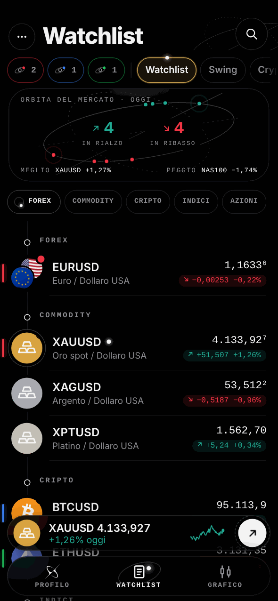
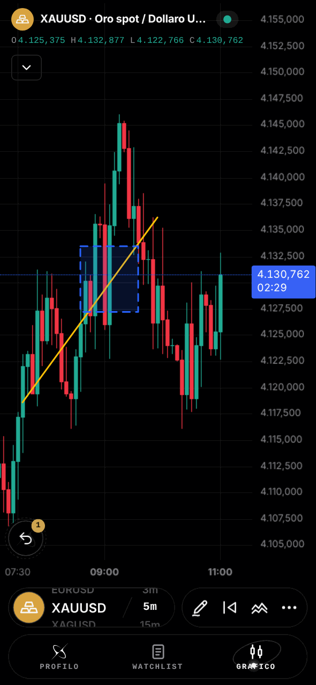

# NexusCharts

**Grafici in tempo reale, indicatori, script e alert — sempre in tasca.**
Un'app di grafici veloce e bella per iPhone, Android e computer, con un design nero assoluto ispirato alle orbite.

[English](README.md) · **Italiano** · [Español](README.es.md) · [Français](README.fr.md) · [Deutsch](README.de.md)

<table>
  <tr>
    <td align="center" width="25%"> 1. Benvenuto</td>
    <td align="center" width="25%"> 2. Accesso</td>
    <td align="center" width="25%"> 3. Watchlist</td>
    <td align="center" width="25%"> 4. Segnali</td>
  </tr>
  <tr>
    <td align="center" width="25%"> 5. Grafico e disegni</td>
    <td align="center" width="25%"> 6. Indicatori</td>
    <td align="center" width="25%"> 7. Editor di script</td>
    <td align="center" width="25%"> 8. Bar Replay</td>
  </tr>
</table>

---

## 📖 Indice

- [Cos'è NexusCharts](#-cosè-nexuscharts)
- [Funzioni](#-funzioni)
- [Installazione](#-installazione)
- [Come ottenere l'accesso](#-come-ottenere-laccesso)
- [Compatibilità](#-compatibilità)
- [Privacy e sicurezza](#-privacy-e-sicurezza)
- [Come è fatta](#%EF%B8%8F-come-è-fatta)
- [Numeri di versione](#-numeri-di-versione)
- [Domande frequenti](#-domande-frequenti)
- [Prossimamente](#-prossimamente)
- [Riconoscimenti](#-riconoscimenti)

---

## ✨ Cos'è NexusCharts

NexusCharts è una **web app** che si installa sulla schermata Home e funziona come un'app vera: a tutto schermo, con la sua icona, senza passare dall'App Store.
È pensata per i trader che vogliono **grafici puliti, prezzi in tempo reale, indicatori e strumenti di disegno** sul telefono, senza limiti, pubblicità o abbonamenti.

| | |
|---|---|
| ⚡ **Prezzi live** | I prezzi arrivano in diretta dal nostro server dati, spesso più volte al secondo |
| 📈 **42 indicatori + i tuoi script** | Libreria integrata e un motore compatibile con Pine Script™ |
| 🔔 **Alert veri** | Notifiche push anche ad app chiusa |
| 📱 **Come un'app vera** | Tutto schermo, vibrazione al tocco, animazioni fluide, niente barre del browser |
| 🔄 **Sempre aggiornata** | Ogni volta che la apri hai l'ultima versione, in automatico |
| 🌍 **5 lingue · 2 temi** | Italiano, inglese, spagnolo, francese, tedesco · Scuro e chiaro |

> 📝 Le novità di ogni versione sono nella pagina [Releases](../../releases).

### 🆕 Novità della 1.3.5 — Tutte le palline pulsano

- 🪐 **Orbita del mercato**: ora pulsa la pallina di ogni strumento, non solo quella del migliore e del peggiore.

### In precedenza, nella 1.3.4 — Orbita del mercato più rapida

- 🪐 **Orbita del mercato** nella Watchlist: si aggiorna appena cambia un prezzo, e una coppia a −0,00% ora conta come in ribasso, come nella sua riga.
- 📡 **Fonti dati**: prezzi e candele sono indicati come *Powered by NexusCharts*.

### In precedenza, nella 1.3.3 — Candele giornaliere più pulite

- 🕯️ **Grafico giornaliero**: la piccola candela della domenica sera (riapertura del mercato) ora fa parte della candela del lunedì, come sulle piattaforme di trading. Ne beneficiano anche le candele settimanali e mensili. Le cripto, che si scambiano anche nel weekend, mantengono le candele di sabato e domenica.

In precedenza, nella 1.3.2 — Più ordinata

- 📋 **Watchlist**: la categoria *Azioni* si vede come le altre, senza lo stato della Borsa accanto al nome.
- 🧹 Tolti gli ultimi resti del vecchio collegamento al broker: messaggio di errore di connessione più chiaro e «Account NexusCharts» nel Profilo.
- 📖 README: la roadmap ora indica 79 strumenti.

In precedenza, nella 1.3.1 — Più chiara nei risultati di Google

- 🔎 **Nome del sito**: nei risultati di Google e nelle anteprime dei link il sito si chiama semplicemente *NexusCharts*.
- 📝 **Descrizione aggiornata**: ora cita Gold, Forex, Crypto, Indices e Stocks, senza il vecchio «Stocks coming soon».

In precedenza, nella 1.3.0 — Azioni

- 📈 **Arrivano le azioni**: Apple, Microsoft, NVIDIA, Amazon, Alphabet (Google), Meta e Tesla, con prezzi in diretta durante la seduta di New York e lo storico delle candele.
- 🍎 **Loghi delle aziende** come icone rotonde, salvati dentro l'app.
- 🕘 **Stato della Borsa**: accanto ad *Azioni* nella Watchlist vedi se la Borsa di New York è Aperta, in Pre-market o Chiusa. A Borsa chiusa vedi l'ultimo prezzo della seduta; festività e chiusure anticipate sono comprese.
- 🔎 La categoria *Azioni* ora c'è anche nella ricerca e nella configurazione del primo avvio, come le altre.
- 📘 FAQ aggiornate con gli account NexusCharts.

---

## 🚀 Funzioni

### 📋 Watchlist
- 79 strumenti: Forex, metalli, energia, indici, cripto e 7 azioni USA, divisi per categoria
- Cerca qualsiasi simbolo e aggiungilo con un tocco
- Prezzo live, variazione giornaliera in punti e percentuale, icone con bandiere e monete
- Mini player in basso con il simbolo selezionato e il suo grafichino
- **Più watchlist** (*Tutte le watchlist*: crea, rinomina, elimina) e **Segnali** colorati con le loro schede
- Tieni premuto un pair per Segnale e Rimuovi

### 📊 Grafico
- Grafico a tutto schermo con **aggiornamento live** e **conto alla rovescia** della candela
- **Timeframe:** secondi 1s · 5s · 10s · 15s · 30s · 45s — minuti 1m · 3m · 5m · 15m · 30m · 45m — ore 1H · 2H · 3H · 4H — giorni 1D · 1W · 1M · 3M · 6M · 12M
- **Tipi di grafico:** Candele · Barre · Linea · Area · Heikin Ashi
- **Colori personalizzati:** corpo, bordi e stoppini delle candele con opacità, più sfondo e scale del grafico
- **Selettore rapido:** tieni premuto e scorri sulla pillola del simbolo o del timeframe per cambiarlo al volo
- **Mirino** con etichette di prezzo e orario e **pulsante "+"** per creare alert al volo
- **Confronta** un secondo simbolo in percentuale
- Pizzica per lo zoom, trascina per scorrere, condividi un'immagine del grafico

### 📈 Indicatori
- Schermata **Indicatori e metriche** con ricerca, **Preferiti** (tocca la stellina) e **I miei script**
- **34 Tecnici:** SMA, EMA, WMA, HMA, VWMA, ALMA, MA Ribbon, Bande di Bollinger (+ %B e BandWidth), Keltner, Donchian, Envelopes, Supertrend, Ichimoku, VWAP, Regressione lineare, RSI, Stoch RSI, Stocastico, MACD, CCI, ADX, ATR, MFI, Williams %R, Momentum, ROC, Awesome Oscillator, Aroon, OBV, Volume, Pivot Points, ZigZag
- **8 Fondamentali** (calcolati dai prezzi): massimo/minimo del giorno e della settimana precedente, apertura giornaliera, range medio giornaliero, variazione giornaliera %, volatilità storica, massimo/minimo a 52 settimane, massimo/minimo di sessione
- **Legenda compatta:** tocca un indicatore per **mostrarlo/nasconderlo**, aprire le **impostazioni** o **toglierlo**
- **Finestra impostazioni** con **Input**, **Stile** (visibilità, colore e spessore di ogni linea) e **Visibilità** (minuti / ore / giorni)
- **Menu •••:** ripristina le impostazioni o **salva come predefinito** per la prossima volta che lo aggiungi

### 🧩 Editor script
- Scrivi i tuoi indicatori in un linguaggio **compatibile con Pine Script™** (v5/v6)
- Editor di codice con numeri di riga, controllo errori e console
- Supporta plot, forme, box, linee, etichette, tabelle, riempimenti, input, alert, timeframe superiori e sessioni
- Salva i tuoi script e aggiungili al grafico da **I miei script**
- **Minimappa** del codice a destra: tocca o trascina per muoverti negli script lunghi

### ✏️ Strumenti di disegno
Salvati in automatico per ogni simbolo.

| Gruppo | Strumenti |
|---|---|
| Trend | Trendline · Linea orizzontale · Canale parallelo |
| Previsione e misurazione | Posizione long · Posizione short (con target, stop e R:R) |
| Figure | Pennello · Freccia · Rettangolo · Percorso · Ellisse |
| Annotazioni | Testo · Nota |

Seleziona un disegno per spostarlo, cambiargli colore, **spessore e stile** o eliminarlo. Il pulsante **Annulla** torna indietro fino a 30 passi.

### 🔔 Alert
- Crea un alert sul prezzo dal **"+"** del mirino o dalla gestione **Alert**
- Linea dell'alert sul grafico: toccala per eliminarla
- Elenco attivi / non attivi, annulla ed elimina
- **Notifiche push anche ad app chiusa** (si disattivano da Profilo › Notifiche)

### ⏪ Bar Replay
- Metti una **linea guida** sulla candela esatta che vuoi e parti da lì
- Riproduci da 1x a 10x o avanza una candela alla volta: perfetto per il backtest

### 🧭 Hub del grafico
| Sezione | Cosa fa |
|---|---|
| **Layout** | Nuovo · Salva · Apri le tue configurazioni del grafico |
| **Grafico** | Tipologia, impostazioni grafico, canvas, dettagli simbolo |
| **Analisi** | Confronta · Bar Replay · Alert · Tecnici · Editor script |
| **Tecnici** | Indicatore compra/vendi da oscillatori e medie mobili |
| **Condividi** | Crea un'immagine del grafico e apre la condivisione |

### 👤 Profilo e impostazioni
- Tema (scuro/chiaro), lingua e notifiche
- Modulo per segnalare un problema o proporre un'idea
- Aggiorna dati, ripristino sicuro, esci

---

## 📲 Installazione

> 🌐 L'indirizzo dell'app è **[nexuscharts.app](https://nexuscharts.app)**.

> NexusCharts si installa dal browser: niente App Store o Play Store.

### 🍎 iPhone (Safari)
1. Apri il link di NexusCharts con **Safari**.
2. Tocca **Condividi** (il quadrato con la freccia). Su iOS 26 tocca prima i **tre puntini ⋯**, poi **Condividi**.
3. Tocca **Aggiungi alla schermata Home** (se non lo vedi, tocca **Mostra altro**).
4. Lascia attivo **Apri come web app**, controlla che il nome sia **NexusCharts** e tocca **Aggiungi**.
5. Apri **NexusCharts** dalla schermata Home.

### 🤖 Android (Chrome)
1. Apri il link di NexusCharts con **Chrome**.
2. Tocca i **tre puntini ⋮** in alto a destra.
3. Tocca **Installa app** (oppure **Aggiungi a schermata Home**) e conferma.

### 💻 Computer (Chrome / Edge)
1. Apri il link di NexusCharts.
2. Clicca l'**icona di installazione** nella barra degli indirizzi, oppure usala in una normale scheda.

> 💡 La stessa guida è dentro l'app: tocca **Installa** in alto a destra nella schermata di accesso (compare solo quando l'app è aperta dal browser).

---

## 🔑 Come ottenere l'accesso

1. Apri **[nexuscharts.app](https://nexuscharts.app)** e tocca **Crea un account**.
2. Scegli username, email e password, e conferma di avere almeno 18 anni e di aver letto l'Informativa Privacy.
3. Inserisci il codice di 6 cifre che arriva per email e sei dentro.

Da quel momento l'app ti fa entrare da sola. Se cambi telefono basta accedere con username o email e password.

Hai un **codice amico**? Tocca **Entra con un codice** e scrivilo (formato `XXXX-XXXX`): funziona su un solo dispositivo.

> 💬 Serve aiuto? Scrivi a **support@nexuscharts.app**.

---

## ✅ Compatibilità

| Dispositivo | Browser | Stato |
|---|---|---|
| iPhone (iOS 16.4 o successivo) | Safari | ✅ Consigliato |
| iPhone | Chrome / Edge | ✅ Funziona (installa da Condividi) |
| Android 10 o successivo | Chrome | ✅ Supportato |
| Android | Samsung Internet / Edge | ✅ Funziona |
| iPad | Safari | ⚠️ Funziona, pensata per telefoni |
| Computer | Chrome / Edge / Safari | ⚠️ Funziona, versione completa per computer in arrivo |

**Requisiti:** una connessione a internet. Su iPhone le notifiche push richiedono l'app installata sulla schermata Home.

---

## 🔒 Privacy e sicurezza

- 👤 Per l'account servono solo **username, email e password**. La password non la vediamo mai: sul server c'è solo una sua impronta cifrata.
- 📜 Tutti i dettagli sono nell'**[Informativa Privacy](https://nexuscharts.app/privacy.html)**.
- 📱 Disegni, layout, indicatori, script e impostazioni restano **solo sul tuo dispositivo**.
- 📡 Il server dati conserva solo i prezzi di mercato: nessun indirizzo IP e nessun dato personale.
- 🔔 Se attivi le notifiche, i tuoi alert attivi vengono tenuti sul server solo per avvisarti; elimini l'alert e sparisce.
- 🔐 In questo repository non ci sono password né chiavi private.
- 🛡️ **Protezione contro chi prova a indovinare i codici**: dopo troppi codici sbagliati dalla stessa rete, l'accesso si mette in pausa per un po' e l'app mostra un messaggio chiaro. I codici validi e i dispositivi collegati non vengono toccati.
- 🧹 **Ripristina l'app** cancella tutto quello che è salvato sul dispositivo.

---

## 🏗️ Come è fatta

- 🖥️ **L'app** (quello che vedi sullo schermo) sta in questo repository ed è pubblicata come web app.
- ⚙️ **Il motore** gira su Cloudflare: un **server degli account** (registrazione, accesso, email), un **server dati** che manda i prezzi in diretta e conserva lo storico delle candele, e un server per i codici amico e gli alert. Sono gestiti a parte e non fanno parte di questo repository.
- 🔐 Chiavi e password stanno solo nelle impostazioni cifrate del motore, mai nel codice.

---

## 🔢 Numeri di versione

Le versioni hanno tre numeri, **MAGGIORE.MINORE.CORREZIONE** (per esempio 0.43.0):

- **Primo numero**: cambiamenti grandi.
- **Numero centrale**: nuove funzioni.
- **Ultimo numero**: correzioni e miglioramenti.

---

## ❓ Domande frequenti

<b>Devo pagare o abbonarmi?</b>

No. Installare e usare NexusCharts è gratis: ti basta creare un account gratuito con username, email e password.

<b>Mi serve un conto con un broker?</b>

No. Entri con il tuo account NexusCharts, senza registrarti da nessun broker.

<b>Posso fare trading dall'app?</b>

No. NexusCharts serve solo per grafici e analisi: non apre mai ordini.

<b>Posso usare i miei indicatori Pine Script™?</b>

Sì. Incolla lo script nell'Editor script, salvalo e aggiungilo da I miei script. La maggior parte delle funzioni v5/v6 è supportata; se qualcosa non lo è, la console ti dice la riga.

<b>Gli alert funzionano ad app chiusa?</b>

Sì, con le notifiche push attive. Su iPhone l'app deve essere installata sulla schermata Home.

<b>Il codice amico dice che è già usato su un altro dispositivo.</b>

Ogni codice amico funziona su un solo dispositivo. Su un altro dispositivo entra con un account NexusCharts gratuito: funziona su tutti i tuoi dispositivi.

<b>Devo aggiornare l'app?</b>

No. Si aggiorna da sola ogni volta che la apri.

<b>Disegni e indicatori si sincronizzano tra dispositivi?</b>

Non ancora: restano sul dispositivo dove li hai creati.

---

## 🗺️ Prossimamente

| Stato | Funzione |
|---|---|
| ✅ | Watchlist, grafico live, timeframe, tipi di grafico, colori personalizzati |
| ✅ | Strumenti di disegno, Bar Replay, Hub del grafico, layout |
| ✅ | 42 indicatori integrati, preferiti, impostazioni indicatore |
| ✅ | Motore compatibile con Pine Script™ ed editor script |
| ✅ | Alert sul prezzo con notifiche push |
| ✅ | 5 lingue (tedesco dalla 0.44.0), tema scuro e chiaro |
| ✅ | Design 3.0: schermate di benvenuto, animazione del logo, menu lingue a orbita |
| ✅ | Accesso Design 3.0: logo a orbite, codice in 8 caselle, bandiere rotonde |
| ✅ | Design 3.0 dentro l'app, più watchlist, Segnali, spessore/stile dei disegni e Annulla |
| ✅ | Server dati nostro: prezzi in diretta, 79 strumenti, nomi in 5 lingue |
| ✅ | Account NexusCharts, nuovo indirizzo nexuscharts.app, Informativa Privacy |
| ✅ | Azioni: Apple, Microsoft, NVIDIA, Amazon, Alphabet, Meta, Tesla, con gli orari di Borsa |
| 🔜 | Storico delle candele più lungo (anni) |
| 🔜 | Versione completa per computer |
| 💡 | Sincronizzazione tra dispositivi |

---

## 🙏 Riconoscimenti

- Grafici realizzati con [TradingView Lightweight Charts™](https://www.tradingview.com/lightweight-charts/) (Apache 2.0).
- Dati di mercato forniti dai server NexusCharts. I prezzi servono per l'analisi e possono essere diversi da quelli del tuo broker.
- Icone cripto da [cryptocurrency-icons](https://github.com/spothq/cryptocurrency-icons) (CC0 1.0).
- Loghi delle azioni: Apple, NVIDIA, Google, Meta e Tesla da [Simple Icons](https://simpleicons.org) (CC0 1.0); Microsoft e Amazon da [Wikimedia Commons](https://commons.wikimedia.org) (pubblico dominio). I loghi sono marchi dei rispettivi proprietari e servono solo a riconoscere il titolo; NexusCharts non è legata a queste aziende.
- TradingView e Pine Script sono marchi di TradingView, Inc. NexusCharts non è affiliata a TradingView.

---

## ⚠️ Avvertenza

NexusCharts è uno strumento di analisi. Niente nell'app è un consiglio finanziario. Il trading comporta rischi: fai sempre le tue valutazioni.

**© 2026 NexusCharts — Tutti i diritti riservati.**

