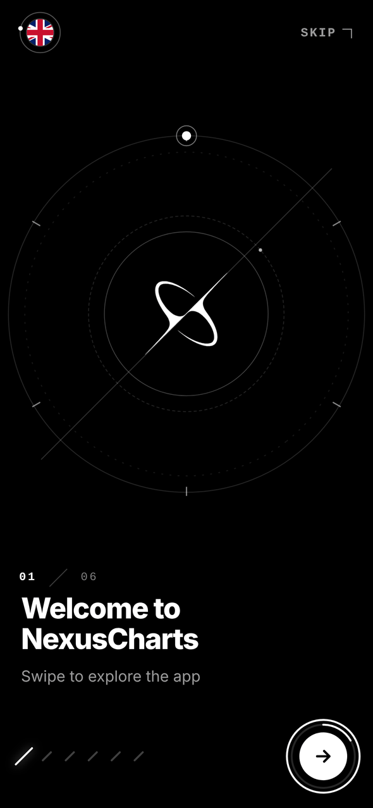
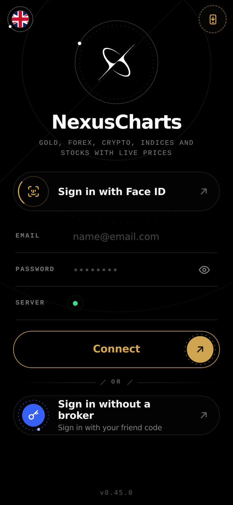
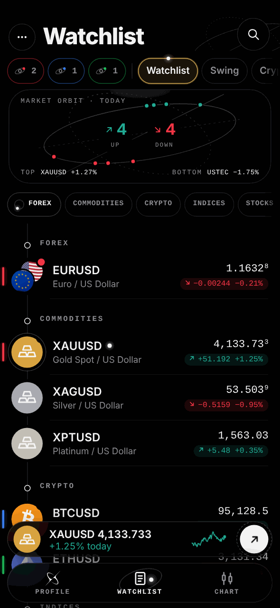
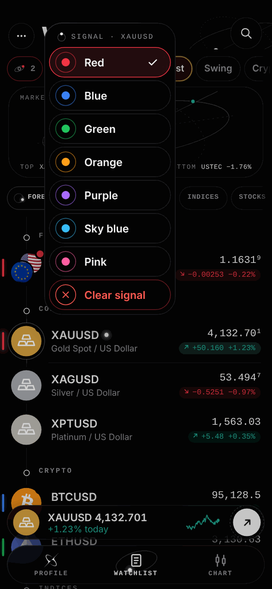
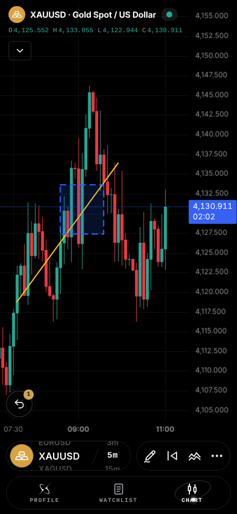
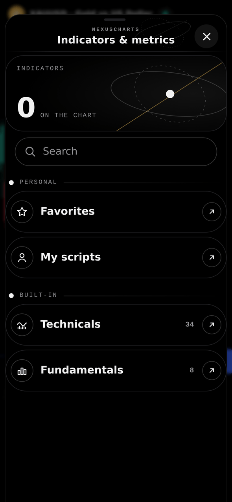
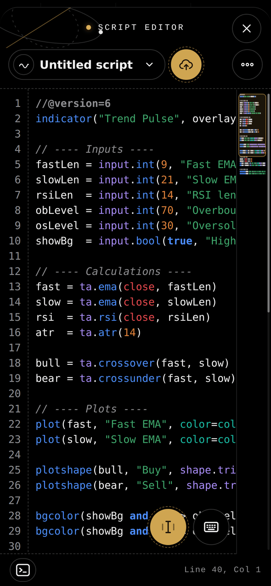
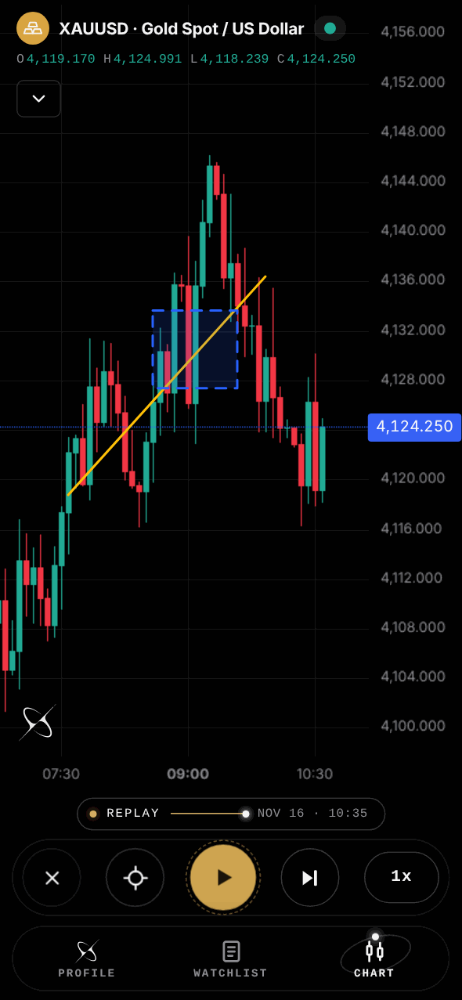

# NexusCharts

**Real-time charts, indicators, scripts and alerts — right in your pocket.**
A fast, beautiful charting app for iPhone, Android and desktop, with a pure-black, orbit-inspired design.

**English** · [Italiano](README.it.md) · [Español](README.es.md) · [Français](README.fr.md) · [Deutsch](README.de.md)

<table>
  <tr>
    <td align="center" width="25%"> 1. Welcome</td>
    <td align="center" width="25%"> 2. Sign-in</td>
    <td align="center" width="25%"> 3. Watchlist</td>
    <td align="center" width="25%"> 4. Signals</td>
  </tr>
  <tr>
    <td align="center" width="25%"> 5. Chart & drawings</td>
    <td align="center" width="25%"> 6. Indicators</td>
    <td align="center" width="25%"> 7. Script editor</td>
    <td align="center" width="25%"> 8. Bar Replay</td>
  </tr>
</table>

---

## 📖 Contents

- [What is NexusCharts](#-what-is-nexuscharts)
- [Features](#-features)
- [Installation](#-installation)
- [How to get access](#-how-to-get-access)
- [Compatibility](#-compatibility)
- [Privacy & security](#-privacy--security)
- [How it's built](#%EF%B8%8F-how-its-built)
- [Versioning](#-versioning)
- [FAQ](#-faq)
- [Roadmap](#-roadmap)
- [Credits](#-credits)

---

## ✨ What is NexusCharts

NexusCharts is a **web app** that installs on your Home Screen and works like a real app: full screen, with its own icon, no App Store needed.
It's built for traders who want **clean charts, live prices, indicators and drawing tools** on their phone, without limits, ads or subscriptions.

| | |
|---|---|
| ⚡ **Live prices** | Prices stream live from our own data server, often several times per second |
| 📈 **42 indicators + your scripts** | Built-in library and a Pine Script™-compatible engine |
| 🔔 **Real alerts** | Push notifications even when the app is closed |
| 📱 **Native feel** | Full screen, haptic feedback, smooth animations, no browser bars |
| 🔄 **Always updated** | Every time you open it you get the latest version automatically |
| 🌍 **5 languages · 2 themes** | Italian, English, Spanish, French, German · Dark and light |

> 📝 What's new in each version: see the [Releases](../../releases) page.

### 🆕 New in 1.6.0 — Legal in Design 3.0

- ⚖️ **Profile › Legal** now looks like the rest of the app: a menu of sections (risk disclaimer, terms, privacy, contributions, credits, contact), each opening its own page.
- 💬 **Contact**: message us on Telegram or write to support@nexuscharts.app. These are the only official channels.

### Previously in 1.5.0 — Our social profiles

- 📣 **Profile › Social**: the official Telegram channel, Instagram, TikTok, YouTube and X, each with its own icon. A tap opens the social app straight on our page (or the website if the app isn't installed).

### Previously in 1.4.2 — Steadier pages

- 📋 **Watchlist and Profile** only scroll up and down: dragging a pair sideways no longer moves the whole page.

Previously in 1.4.1 — Simpler Profile

- 👤 **Profile**: the *Data sources* page is gone. The chart and logo credits are now in *Legal*, under *Credits*.

Previously in 1.4.0 — Daily close at 5 pm New York

- 🕯️ **Daily candles like the brokers'**: gold, metals, energy, Forex and indices now close their day at 5 pm New York time (11 pm in Italy). Sunday evening is part of Monday, and the live candle switches to the new day right at the close.
- 🪙 Crypto keeps closing at midnight UTC, stocks follow the New York session.
- 📡 **Data sources** explains it; the daily history before 12 November 2026 still closes at midnight UTC.

Previously in 1.3.5 — Every dot pulses

- 🪐 **Market orbit**: every instrument's dot now pulses, not just the best and the worst.

---

## 🚀 Features

### 📋 Watchlist
- 79 instruments: Forex, metals, energy, indices, crypto and 7 US stocks, grouped by category
- Search any symbol and add it with one tap
- Live price, daily change in points and percent, flag/coin icons
- Mini player at the bottom with the selected symbol and its sparkline
- **Multiple watchlists** (*All watchlists*: create, rename, delete) and colour **Signals** with their own tabs
- Long-press a pair for Signal and Remove

### 📊 Chart
- Full-screen chart with **live updates** and a candle **countdown**
- **Timeframes:** seconds 1s · 5s · 10s · 15s · 30s · 45s — minutes 1m · 3m · 5m · 15m · 30m · 45m — hours 1H · 2H · 3H · 4H — days 1D · 1W · 1M · 3M · 6M · 12M
- **Chart types:** Candles · Bars · Line · Area · Heikin Ashi
- **Custom colors:** candle body, borders and wicks with opacity, plus canvas background and scales
- **Quick picker:** hold and swipe on the symbol or timeframe pill to change it instantly
- **Crosshair** with price and time labels and a **"+" button** for quick alerts
- **Compare** a second symbol in percentage mode
- Pinch to zoom, drag to scroll, share a snapshot of the chart

### 📈 Indicators
- **Indicators & metrics** screen with search, **Favorites** (tap the star) and **My scripts**
- **34 Technicals:** SMA, EMA, WMA, HMA, VWMA, ALMA, MA Ribbon, Bollinger Bands (+ %B and BandWidth), Keltner, Donchian, Envelopes, Supertrend, Ichimoku, VWAP, Linear Regression, RSI, Stoch RSI, Stochastic, MACD, CCI, ADX, ATR, MFI, Williams %R, Momentum, ROC, Awesome Oscillator, Aroon, OBV, Volume, Pivot Points, ZigZag
- **8 Fundamentals** (computed from prices): Previous Day High/Low, Previous Week High/Low, Daily Open, Average Daily Range, Daily Change %, Historical Volatility, 52-Week High/Low, Session High/Low
- **Compact legend:** tap an indicator to **show/hide** it, open its **settings** or **remove** it
- **Settings window** with **Inputs**, **Style** (visibility, color, width of each line) and **Visibility** (minutes / hours / days)
- **••• menu:** reset settings or **save as default** for the next time you add it

### 🧩 Script editor
- Write your own indicators in a **Pine Script™-compatible** language (v5/v6)
- Code editor with line numbers, error check and console
- Supports plots, shapes, boxes, lines, labels, tables, fills, inputs, alerts, higher timeframes and sessions
- Save your scripts and add them to the chart from **My scripts**
- **Minimap** of the code on the right: tap or drag to move through long scripts

### ✏️ Drawing tools
Saved automatically for each symbol.

| Group | Tools |
|---|---|
| Trend | Trend line · Horizontal line · Parallel channel |
| Forecasting & measurement | Long position · Short position (with target, stop and R:R) |
| Shapes | Brush · Arrow · Rectangle · Path · Ellipse |
| Annotations | Text · Note |

Select a drawing to move it, change its color, **line width and style** or delete it. The **Undo** button takes back up to 30 steps.

### 🔔 Alerts
- Create a price alert from the crosshair **"+"** or from the **Alerts** manager
- Alert line on the chart: tap it to delete it
- Active / inactive list, cancel and delete
- **Push notifications even when the app is closed** (can be turned off in Profile › Notifications)

### ⏪ Bar Replay
- Place a **guide line** on the exact candle you want and start from there
- Play at 1x–10x speed or step one candle at a time — perfect for backtesting

### 🧭 Chart Hub
| Section | What it does |
|---|---|
| **Layouts** | New · Save · Open your saved chart setups |
| **Chart** | Chart type, chart settings, canvas, symbol details |
| **Analysis** | Compare · Bar Replay · Alerts · Technicals · Script editor |
| **Technicals** | Buy/sell gauge from oscillators and moving averages |
| **Share** | Creates an image of your chart and opens the share sheet |

### 👤 Profile & settings
- Theme (dark/light), language and notifications
- Feedback form to report a problem or suggest an idea
- Social: Telegram channel, Instagram, TikTok, YouTube and X, opened straight in their apps
- Refresh data, safe reset, sign out

---

## 📲 Installation

> 🌐 The app lives at **[nexuscharts.app](https://nexuscharts.app)**.

> NexusCharts is installed from the browser — no App Store or Play Store needed.

### 🍎 iPhone (Safari)
1. Open the NexusCharts link in **Safari**.
2. Tap **Share** (the square with the arrow). On iOS 26 tap the **three dots ⋯** first, then **Share**.
3. Tap **Add to Home Screen** (if you don't see it, tap **View More**).
4. Keep **Open as Web App** on, check the name is **NexusCharts**, tap **Add**.
5. Open **NexusCharts** from your Home Screen.

### 🤖 Android (Chrome)
1. Open the NexusCharts link in **Chrome**.
2. Tap the **three dots ⋮** at the top right.
3. Tap **Install app** (or **Add to Home screen**) and confirm.

### 💻 Desktop (Chrome / Edge)
1. Open the NexusCharts link.
2. Click the **install icon** in the address bar, or open it in a normal tab.

> 💡 The same guide is available inside the app: tap **Install** at the top right of the sign-in screen (it appears only when the app is opened from the browser).

---

## 🔑 How to get access

1. Open **[nexuscharts.app](https://nexuscharts.app)** and tap **Create an account**.
2. Pick a username, email and password, and confirm you are 18 or older and have read the Privacy Policy.
3. Enter the 6-digit code sent by email and you're in.

From then on the app signs you in by itself. On a new phone just sign in with your username or email and password.

Have a **friend code**? Tap **Use a code** and type it (format `XXXX-XXXX`): it works on one device only.

> 💬 Need help? Write to **support@nexuscharts.app**.

---

## ✅ Compatibility

| Device | Browser | Status |
|---|---|---|
| iPhone (iOS 16.4 or later) | Safari | ✅ Recommended |
| iPhone | Chrome / Edge | ✅ Works (install via Share) |
| Android 10 or later | Chrome | ✅ Supported |
| Android | Samsung Internet / Edge | ✅ Works |
| iPad | Safari | ⚠️ Works, designed for phones |
| Desktop | Chrome / Edge / Safari | ⚠️ Works, full desktop version coming |

**Requirements:** an internet connection. Push notifications on iPhone need the app installed on the Home Screen.

---

## 🔒 Privacy & security

- 👤 An account needs only a **username, email and password**. We never see your password: the server keeps only an encrypted fingerprint of it.
- 📜 All the details are in the **[Privacy Policy](https://nexuscharts.app/privacy.html)**.
- 📱 Drawings, layouts, indicators, scripts and settings are saved **only on your device**.
- 📡 The data server stores only market prices: no IP addresses and no personal data.
- 🔔 If you turn on notifications, your active price alerts are kept on the server only to notify you; delete an alert and it's gone.
- 🔐 No passwords or private keys are stored in this repository.
- 🛡️ **Protection against code guessing**: after too many wrong codes from the same network, sign-in pauses for a while and the app shows a clear message. Valid codes and linked devices are never affected.
- 🧹 **Reset app** erases everything saved on the device.

---

## 🏗️ How it's built

- 🖥️ **The app** (what you see on your screen) lives in this repository and is published as a web app.
- ⚙️ **The engine** runs on Cloudflare: an **account server** (sign-up, sign-in, emails), a **data server** that streams live prices and keeps the candle history, and a server for friend codes and alerts. They are managed separately and are not part of this repository.
- 🔐 Keys and passwords live only in the engine's encrypted settings, never in the code.

---

## 🔢 Versioning

Versions use three numbers, **MAJOR.MINOR.PATCH** (for example 0.43.0):

- **First number**: big changes.
- **Middle number**: new features.
- **Last number**: fixes and improvements.

---

## ❓ FAQ

<b>Do I need to pay or subscribe?</b>

No. Installing and using NexusCharts is free — just create a free account with a username, email and password.

<b>Do I need a broker account?</b>

No. You sign in with your NexusCharts account, without any broker registration.

<b>Can I trade from the app?</b>

No. NexusCharts is for charts and analysis only — it never places orders.

<b>Can I use my own Pine Script™ indicators?</b>

Yes. Paste your script in the Script editor, save it and add it from My scripts. Most v5/v6 features are supported; if something isn't, the console tells you the line.

<b>Do price alerts work when the app is closed?</b>

Yes, with push notifications on. On iPhone the app must be installed on the Home Screen.

<b>My friend code says it's already used on another device.</b>

Each friend code works on one device only. On another device, sign in with a free NexusCharts account: it works on all your devices.

<b>Do I need to update the app?</b>

No. It updates itself every time you open it.

<b>Do my drawings and indicators sync between devices?</b>

Not yet: they're saved on the device where you made them.

---

## 🗺️ Roadmap

| Status | Feature |
|---|---|
| ✅ | Watchlist, live chart, timeframes, chart types, custom colors |
| ✅ | Drawing tools, Bar Replay, Chart Hub, layouts |
| ✅ | 42 built-in indicators, favorites, indicator settings |
| ✅ | Pine Script™-compatible engine and script editor |
| ✅ | Price alerts with push notifications |
| ✅ | 5 languages (German added in 0.44.0), dark and light theme |
| ✅ | Design 3.0: welcome screens, logo animation, orbit language menu |
| ✅ | Design 3.0 sign-in: orbit logo, 8-box access code, round flags |
| ✅ | Design 3.0 inside the app, multiple watchlists, Signals, drawing width/style and Undo |
| ✅ | Our own data server: live streaming, 79 instruments, names in 5 languages |
| ✅ | NexusCharts accounts, new address nexuscharts.app, Privacy Policy |
| ✅ | Stocks: Apple, Microsoft, NVIDIA, Amazon, Alphabet, Meta, Tesla, with exchange hours |
| 🔜 | Longer candle history (years) |
| 🔜 | Full desktop version |
| 💡 | Sync between devices |

---

## 🙏 Credits

- Charts powered by [TradingView Lightweight Charts™](https://www.tradingview.com/lightweight-charts/) (Apache 2.0).
- Market data served by the NexusCharts servers. Prices are for analysis and may differ from your broker's.
- Crypto icons from [cryptocurrency-icons](https://github.com/spothq/cryptocurrency-icons) (CC0 1.0).
- Stock logos: Apple, NVIDIA, Google, Meta and Tesla from [Simple Icons](https://simpleicons.org) (CC0 1.0); Microsoft and Amazon from [Wikimedia Commons](https://commons.wikimedia.org) (public domain). The logos are trademarks of their respective owners and are only used to identify the stock; NexusCharts is not affiliated with these companies.
- TradingView and Pine Script are trademarks of TradingView, Inc. NexusCharts is not affiliated with TradingView.

---

## ⚠️ Disclaimer

NexusCharts is an analysis tool. Nothing in the app is financial advice. Trading involves risk: always do your own research.

**© 2026 NexusCharts — All rights reserved.**

